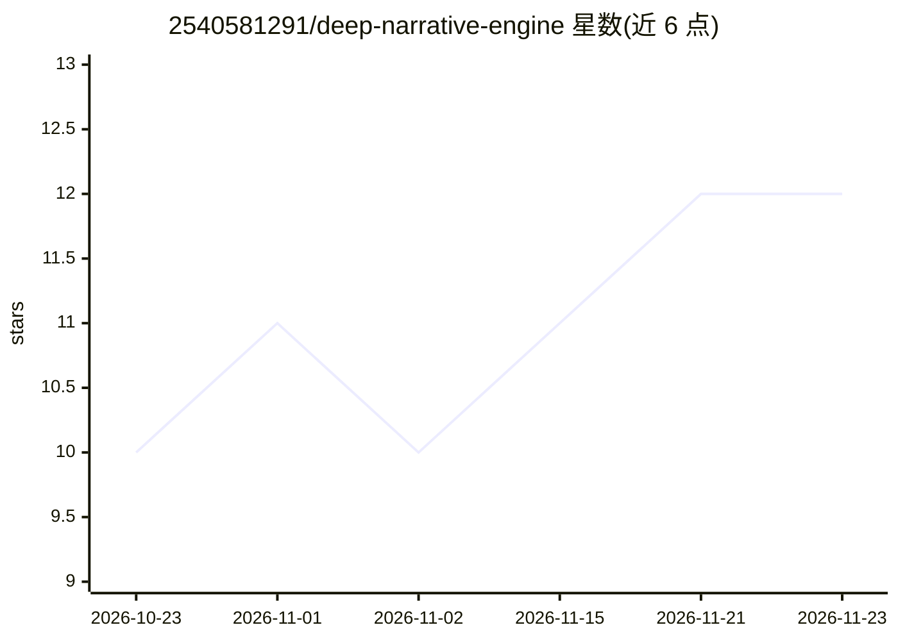

# 2540581291/deep-narrative-engine

⭐ 12 · JavaScript · 推送 2026-10-05 · [GitHub](https://github.com/2540581291/deep-narrative-engine) · 个人维护 · 中文 README

**AI 驱动的成人虚构内容创作桌面工具，以角色卡为核心**

基于 Electron + 原生 JavaScript 的桌面应用，以角色卡为核心载体：支持由 AI 完整生成角色概要、或从小说文本提取角色结构化数据导入为角色卡，并围绕该角色在多种文体模块（小说、诗歌、台本、互动小说、角色聊天等）中产出虚构文字。设计上遵循 AI 优先（先生成提案再人工修改）、零锁定、即时保存、云端大模型为主要生成引擎（本地 LLM 作补充）。需要云端模型 API Key 或本地 LLM 配置方可使用，仅面向 18 岁以上成年用户。

## 筛选速览

| 维度 | 判定 | 备注 |
|---|---|---|
| AI 角色 | `ai-native` | 本体是模型或模型工具 |
| 许可风险 | `none` | — |
| 部署形态 | `library` | 以包/库形式分发 |
| 模型依赖 | — | README 未给出锁定关系 |
| 硬件要求 | — | 无带数字的原话,不猜 |
| 安装摩擦 | `low` | 无编译、无系统依赖或容器化 |
| 成熟度 | — | 结构信号不足 |

## 能力要点

- 角色卡两种获取方式：AI 生成与从小说文本提取结构化角色
- 按文体/题材组织的多个创作模块，共享同一套角色数据作为生成上下文
- 云端与本地多提供商接入的「大模型」区块，含提示词注册表与用量追踪
- 声图创作模块提供生图词典与本地/云端生图 API 支持

## 适用场景

- 围绕自建角色卡持续创作成人小说、短篇与系列作品
- 从已有小说文本提取角色并导入为结构化角色卡
- 用互动分支与角色聊天模块做多角色互动叙事
- 借助生图词典与语音合成产出配套图像与声音素材

## 场景标签

`AI 写作` · 领域:内容生成

## 证据(README 行号)

> L15: **深度-叙事引擎** 是一款 AI 驱动的成人内容创作桌面工具。它以 **AI 为核心**、以**角色卡为核心载体**，帮助创作者围绕角色快速构建、持续深化虚拟人物，并产出各类文体与题材的虚构内容。
> L44: |**AI 生成**|按方向 / 参考灵感，由 AI 完整生成角色概要并填充全部字段（信息、服饰、配饰、体貌特征、性癖标签等），支持深化、扩充、混搭、候选方向等模式。|
> L101: - **云端优先**：云端大模型为主要生成引擎（充分利用大上下文与高能力），本地 LLM 为补充 / 备份。

## 星数曲线

2026-10-23 10 → 2026-11-23 12（+2）

---
*卡片 v1 · prompt 1.4 · 生成 2026-11-19 · 置信度 high · 依据 README sha `e78a2037e8c6` · [字段定义](../../DATASET.md)*
