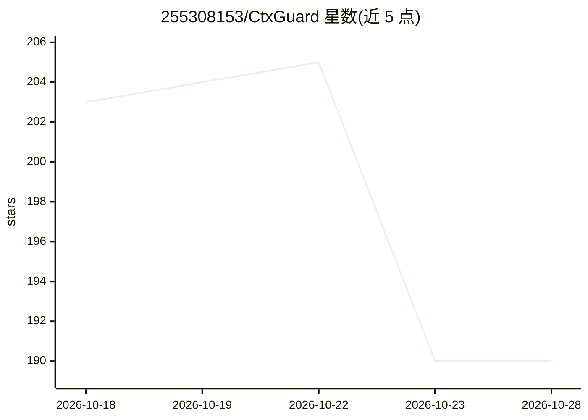

# 255308153/CtxGuard

⭐ 190 · Python · MIT · 推送 2026-10-14 · [GitHub](https://github.com/255308153/CtxGuard) · 个人维护 · 中文 README

**AI Agent 的上下文治理与 Prompt Cache 代理网关**

部署在客户端与大模型服务商之间的透明反向代理网关，面向 Claude Code、Cursor、Codex、Pi Agent 等 AI Agent 用户。在协议中转层实施 Tree-sitter 语法树折叠、Tool 增量差分、日志截断与二进制前缀防抖等操作，以降低 Token 消耗并维持云端前缀缓存命中；另提供 SQLite 指纹池的可逆还原、敏感凭证脱敏、知识图谱记忆与自进化规则引擎。通过 pip 源码安装，CLI 提供一键拉起 Agent、配置桥接等方式接入，含 Web 监控看板。

## 筛选速览

| 维度 | 判定 | 备注 |
|---|---|---|
| AI 角色 | `ai-ecosystem` | LLM/agent 周边工具 |
| 许可风险 | `permissive` | MIT |
| 部署形态 | `library` | 以包/库形式分发 |
| 模型依赖 | locked-api |  |
| 硬件要求 | — | 无带数字的原话,不猜 |
| 安装摩擦 | `low` | 无编译、无系统依赖或容器化 |
| 成熟度 | — | 结构信号不足 |

## 能力要点

- Tree-sitter 多语言语法树折叠（9+ 门语言，函数体存入指纹池可逆还原）
- Tool 影子状态机增量差分，将状态刷新压缩至约 30 Tokens
- 二进制切片透传与 Schema 确定性重排以维持云端 Prompt Cache 命中
- 知识图谱记忆与三级自进化规则学习（LLM/本地 CLI/离线启发式）

## 适用场景

- 降低 Claude Code/Cursor 等 Agent 编码会话的 Token 消耗
- 维持多轮会话的前缀缓存命中以降低延迟与费用
- 通过代理统一接入 OpenAI/Anthropic 兼容端点的多种模型

## 场景标签

`模型网关` · 领域:Agent 开发

## 证据(README 行号)

> L16: **CtxGuard** 是一套部署在客户端与大模型服务商（OpenAI、Anthropic、Google Gemini、xAI Grok、DeepSeek 等）之间的透明反向代理网关。它在协议中转层对出向请求实施轻量级结构化优化
> L66: - **网关层自闭环响应拦截 (CCR Loop)**：在网关层截断拦截云端大模型发出的 `tool_calls: ctx_expand`。网关本地 0.1ms 提取原文并自动在后台发起第 2 轮续写（Continuation R

## 星数曲线

2026-10-18 203 → 2026-10-28 190（-13）

---
*卡片 v1 · prompt 1.4 · 生成 2026-10-22 · 置信度 mid · 依据 README sha `ffa8757e7ad2` · [字段定义](../../DATASET.md)*
