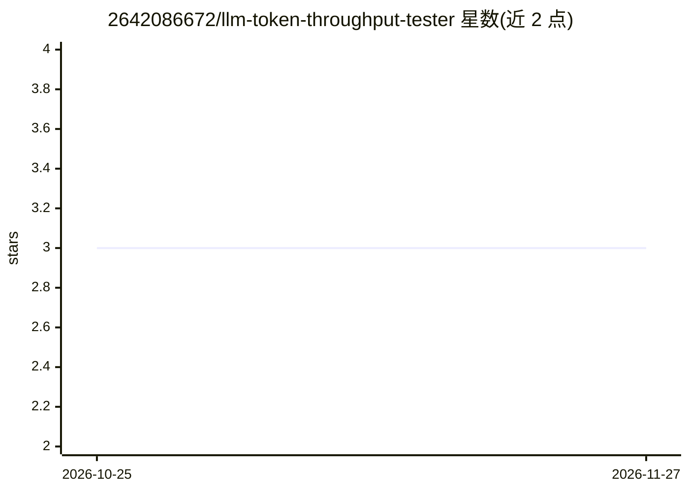

# 2642086672/llm-token-throughput-tester

⭐ 3 · JavaScript · MIT · 推送 2026-10-23 · [GitHub](https://github.com/2642086672/llm-token-throughput-tester) · 个人维护 · 中文 README

**给开发者的 LLM 输出 token 吞吐压测工具**

基于 Python 标准库的本地压测台：服务端计时逐 chunk 打点，浏览器端出图，聚合聚合吞吐、并发解码吞吐、TTFT、TPOT、输出 token、成功率六项指标，并绘制吞吐曲线、TTFT 分布、ITL 分位等四张图表。支持 OpenAI 兼容与 Anthropic 双协议，内置 31 个服务商接入点预设，思考模式下区分 TTFT 与答案首字延迟并单独统计思维链 token。历史记录存浏览器本地，可导出 JSON/CSV。Python 3.8+ 即可运行，零第三方依赖，tiktoken 为可选精度增强。

## 筛选速览

| 维度 | 判定 | 备注 |
|---|---|---|
| AI 角色 | `ai-ecosystem` | LLM/agent 周边工具 |
| 许可风险 | `permissive` | MIT |
| 部署形态 | `library` | 以包/库形式分发 |
| 模型依赖 | local-ok | 支持本地模型 |
| 硬件要求 | — | 无带数字的原话,不猜 |
| 安装摩擦 | `low` | 无编译、无系统依赖或容器化 |
| 成熟度 | — | 结构信号不足 |

## 能力要点

- 服务端 time.perf_counter 微秒级计时，规避浏览器 SSE 误差
- 六项指标 + 四张交互图表，TTFT 分布点击可定位明细行
- 31 个服务商预设与本地部署（vLLM/Ollama 等）接入点
- 思考模式参数按八家官方 wire 格式自动翻译，思维链 token 单独统计

## 适用场景

- 压测 API 服务在不同并发下的输出吞吐饱和点
- 对比各服务商接入点的 TTFT 与延迟抖动
- 本地部署 vLLM/Ollama 后验证模型服务性能
- 对比不同思考级别下的吞吐与答案首字延迟

## 场景标签

`模型评测` · 领域:评测与运维

## 证据(README 行号)

> L3: 压测大模型接口的**输出吞吐能力**。浏览器端出图，服务端做计时。
> L7: 测的是**输出侧**吞吐——模型每秒能吐多少 token，以及在并发下这个数字怎么变。
> L23: - **零第三方依赖**：Python 标准库即可运行，图表原生 Canvas 手绘，无 CDN

## 星数曲线

2026-10-25 3 → 2026-11-27 3（+0）

---
*卡片 v1 · prompt 1.4 · 生成 2026-11-22 · 置信度 mid · 依据 README sha `afcaceb1e989` · [字段定义](../../DATASET.md)*
