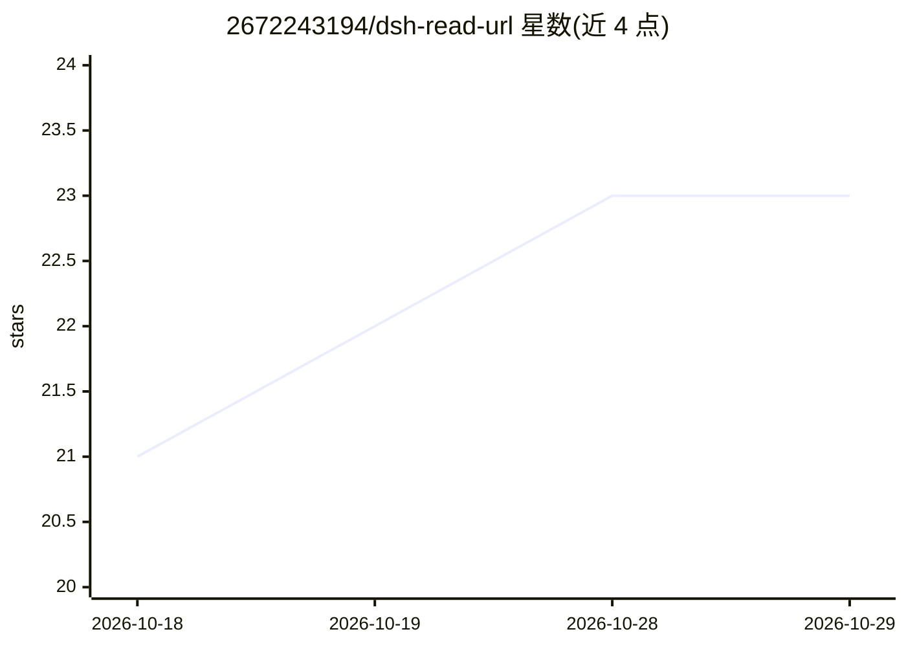

# 2672243194/dsh-read-url

⭐ 23 · JavaScript · MIT · 推送 2026-10-19 · [GitHub](https://github.com/2672243194/dsh-read-url) · 个人维护 · 中文 README

**DeepSeek Harness 的网页读取插件：抓取 URL 并返回紧凑正文/Markdown**

面向 DeepSeek Harness（DSH）的 URL 读取插件：抓取 HTML 页面、JSON API 与 RSS/Atom，自动检测 GBK/GB2312/UTF-8/Big5/Shift-JIS 等编码，提取干净正文并返回面向模型的紧凑文本或结构化 Markdown。核心机制包括段落对齐截断（默认 6000 字符上限）、offset 续读、5 分钟会话缓存、分页文章自动拼接、代理与直连竞速。提供四个工具：read_url、read_url_batch（1-10 页并行）、read_url_site（同站 BFS 爬取）、read_url_links。零运行时依赖、无需 API key，经 DSH 插件市场或 npx 命令安装；并发能力受 DSH 管道约束。

## 筛选速览

| 维度 | 判定 | 备注 |
|---|---|---|
| AI 角色 | `ai-ecosystem` | LLM/agent 周边工具 |
| 许可风险 | `permissive` | MIT |
| 部署形态 | `library` | 以包/库形式分发 |
| 模型依赖 | locked-api |  |
| 硬件要求 | — | 无带数字的原话,不猜 |
| 安装摩擦 | `low` | 无编译、无系统依赖或容器化 |
| 成熟度 | — | 结构信号不足 |

## 能力要点

- 自动编码检测（GBK/GB2312/UTF-8/Big5/Shift-JIS/UTF-16 BOM）
- 段落对齐截断 + offset 续读 + 5 分钟会话缓存
- read_url_batch 最多 10 页并行读取、失败隔离
- read_url_site 同站 BFS 爬取生成紧凑站点地图

## 适用场景

- 让 DSH agent 读取网页并总结要点或对比多来源观点
- 分片阅读超长文章，按需续读控制上下文占用
- 批量抓取多页做资料调研，或爬取整站生成结构地图

## 场景标签

`网页抓取` · 领域:效率与自动化

## 证据(README 行号)

> L10: URL reader plugin for DeepSeek Harness: fetch any URL — **webpages (HTML), JSON APIs, RSS/Atom feeds** — auto-detec
> L50: Implemented per official docs (`docs/capability-seams.md`, `docs/cordis-primer.md`, `docs/tool-execution-pipeline.m
> L70: npx @deepseek-ai/dsh plugin --profile web add github:2672243194/dsh-read-url

## 星数曲线

2026-10-18 21 → 2026-10-29 23（+2）

---
*卡片 v1 · prompt 1.4 · 生成 2026-10-28 · 置信度 high · 依据 README sha `52d3c23ed09d` · [字段定义](../../DATASET.md)*
