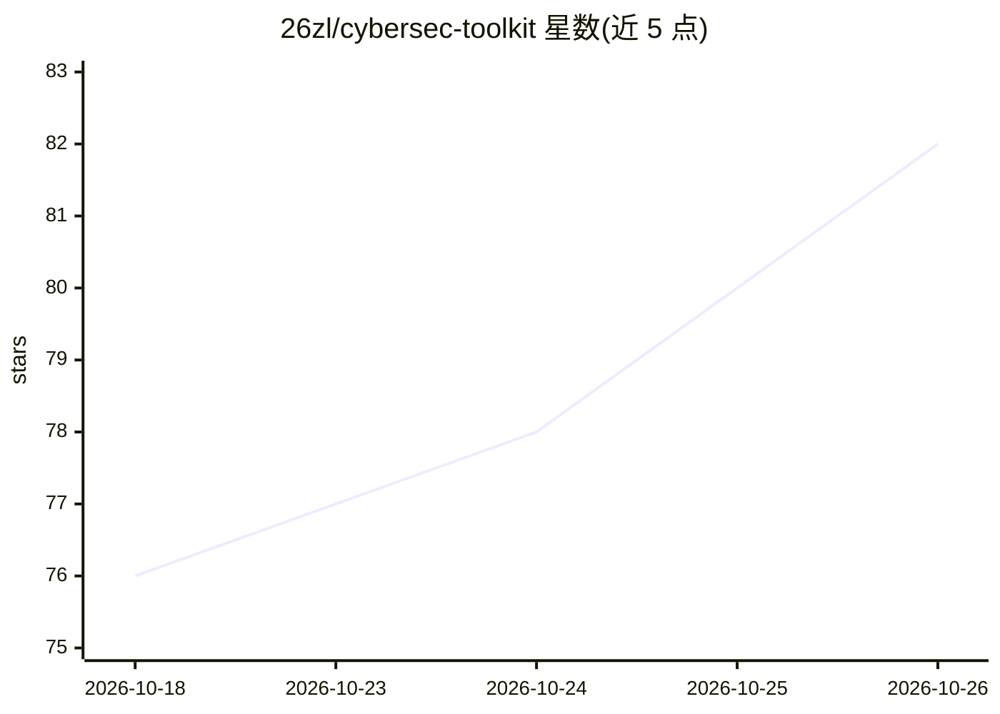

# 26zl/cybersec-toolkit

⭐ 82 · Python · MIT · 推送 2026-10-23 · [GitHub](https://github.com/26zl/cybersec-toolkit) · 个人维护

**AI agent 驱动的安全工具集：一键装 670+ 工具+MCP 治理执行**

面向安全从业者与 CTF/渗透测试/蓝队人员的工具集与 MCP 服务器组合：bash 安装器在 Debian/Ubuntu/Kali、Fedora、Arch、openSUSE 和 Termux 上安装 670+ 安全工具（18 模块、14 profile），MCP 服务器提供 15 个工具供 Claude Code、Codex、Gemini CLI 等 AI 客户端发现、推荐并治理式执行这些工具，默认在一次性 Kata Containers 虚拟机沙箱中运行；另有 872 个 Agent Skills 提供方法论。默认关闭外部网络目标与脚本执行，C2/钓鱼工具需显式开启；安装器不支持 macOS/原生 Windows（需 WSL 或 Docker）。

## 筛选速览

| 维度 | 判定 | 备注 |
|---|---|---|
| AI 角色 | `ai-ecosystem` | LLM/agent 周边工具 |
| 许可风险 | `permissive` | MIT |
| 部署形态 | `desktop` | 安装包/桌面程序 |
| 模型依赖 | — | README 未给出锁定关系 |
| 硬件要求 | — | 无带数字的原话,不猜 |
| 安装摩擦 | `low` | 无编译、无系统依赖或容器化 |
| 成熟度 | — | 结构信号不足 |

## 能力要点

- 670+ 安全工具，18 模块、14 profile、12 种安装方式，覆盖 5 类发行版与 Termux
- MCP 服务器 15 个工具，默认在一次性 Kata VM 沙箱执行，外部目标与脚本执行默认禁用
- 872 个 Agent Skills（31 个原创、841 个策展），可作 Claude Code 插件安装
- 安全治理：注册表允许列表、无 shell 执行、参数净化、审计日志哈希链

## 适用场景

- 在 Linux/Termux 上一条命令批量安装安全测试工具集
- 让 Claude Code 等 AI 客户端在沙箱内发现并执行安全工具完成 CTF/渗透任务
- 通过 profile（如 ctf、redteam）按需安装特定方向工具

## 场景标签

`网络安全` · 领域:学习与行业

## 证据(README 行号)

> L17: __A security toolkit that AI agents can drive, under rules you set.__ One command installs 670+ security tools on L
> L22: |MCP server|15 tools for discovery, advice, and governed execution; external targets and script execution are off b
> L53: Two entry points share one tool registry. An __operator__ runs the bash installer to put tools on disk: on the host

## 星数曲线

2026-10-18 76 → 2026-10-26 82（+6）

---
*卡片 v1 · prompt 1.4 · 生成 2026-10-24 · 置信度 mid · 依据 README sha `4349706bea86` · [字段定义](../../DATASET.md)*
