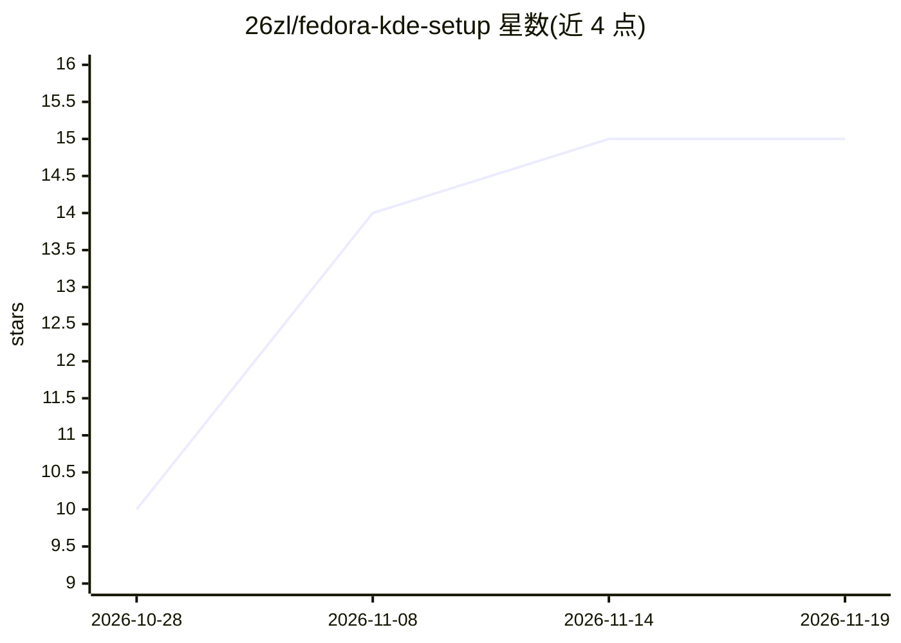

# 26zl/fedora-kde-setup

⭐ 15 · Shell · MIT · 推送 2026-11-14 · [GitHub](https://github.com/26zl/fedora-kde-setup) · 个人维护

**Fedora 45 KDE 装机后自动配置脚本集：按硬件适配游戏与桌面环境**

面向 Fedora 45 KDE Plasma 6 Wayland 的装机后配置仓库：通过硬件检测脚本（hw.sh）区分 NVIDIA/AMD/Intel GPU 与台式/笔记本，自动安装驱动、性能调优（tuned/scx）、KDE 终端美化、Snapper 快照、模拟器、安全加固等，另有可选的本地 LLM（Ollama）、Windows 11 虚拟机与大模型开发环境脚本。脚本自行调用 sudo 且拒绝以 root 运行，仅支持 x86_64 的 Fedora 45，原子变体（Kinoite）不支持；恢复点要求默认 Btrfs 布局，其他布局需确认或中止。

## 筛选速览

| 维度 | 判定 | 备注 |
|---|---|---|
| AI 角色 | `ai-enhanced` | 去掉 AI 部分产品仍成立 |
| 许可风险 | `permissive` | MIT |
| 部署形态 | `desktop` | 安装包/桌面程序 |
| 模型依赖 | — | README 未给出锁定关系 |
| 硬件要求 | — | 无带数字的原话,不猜 |
| 安装摩擦 | `high` | 编译与系统依赖俱全 |
| 成熟度 | `idea` | |

## 能力要点

- 硬件检测自动适配 NVIDIA（含 580xx 旧卡分支）/AMD/Intel 与台式/笔记本路径
- 可选脚本安装本地 Ollama 与模型、Windows 11 虚拟机、CUDA 开发环境
- 预装恢复点依赖 Btrfs 根与同文件系统 /home，非默认布局需确认
- 含 suspend VRAM 检查、外接显示器恢复等系统服务修复

## 适用场景

- 新装 Fedora 45 KDE 后一键完成驱动、游戏性能与美化配置
- NVIDIA + AMD 混合显卡笔记本/台式机的差异化设置
- 双系统机器配置 GRUB 记忆上次启动项
- 在游戏机上额外部署本地 LLM 或 Windows 虚拟机

## 场景标签

 · 领域:操作系统配置/Linux 桌面

## 证据(README 行号)

> L12: Post-installation guide, config files, and scripts for Fedora 45 KDE Plasma 6 on Wayland. Focused on low-latency ga
> L38: The scripts detect the hardware and adapt to it, so the same repo sets up a gaming desktop or a laptop, with an NVI
> L32: |`ollama-setup.sh`|An NVIDIA card and about 12 GB of disk: Ollama 2.5 GB, the model 8.7 GB, the Chatbox app 0.2 GB.

## 星数曲线

2026-10-28 10 → 2026-11-19 15（+5）

---
*卡片 v1 · prompt 1.4 · 生成 2026-11-18 · 置信度 high · 依据 README sha `53d3128d0591` · [字段定义](../../DATASET.md)*
