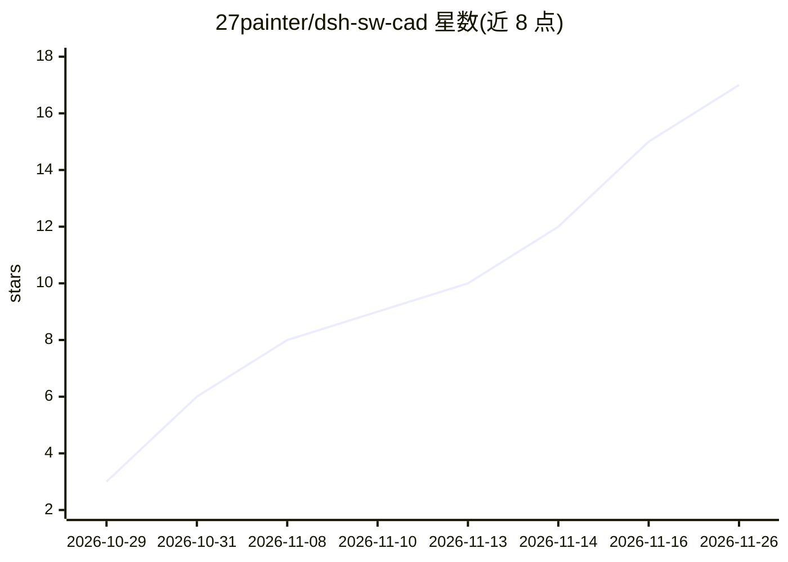

# 27painter/dsh-sw-cad

⭐ 17 · JavaScript · MIT · 推送 2026-11-25 · [GitHub](https://github.com/27painter/dsh-sw-cad) · 个人维护 · 中文 README

**让 AI agent 驱动 SolidWorks/AutoCAD 出图并自检交付**

面向 dsh/Codex 的 CAD 自动化插件包：通过两个 MCP server（AutoCAD 242 工具、SolidWorks 66 工具，均带搜索入口以压缩上下文）让 agent 绘图、建模、导出 STEP/PDF；核心是 `deliver` 交付检查命令，读取磁盘上的 DXF/PDF/STEP/SLDPRT 文件按规则校验（实体、图层、ISO 216 幅面、SHA-256 等），exit 0/1 给出可核验结论；half 模式按 lib/standards.json 校验公差、材料、粗糙度取值。依赖 Windows COM，需先以同一用户启动 CAD 应用。

## 筛选速览

| 维度 | 判定 | 备注 |
|---|---|---|
| AI 角色 | `ai-native` | 本体是模型或模型工具 |
| 许可风险 | `permissive` | MIT |
| 部署形态 | `library` | 以包/库形式分发 |
| 模型依赖 | — | README 未给出锁定关系 |
| 硬件要求 | — | 无带数字的原话,不猜 |
| 安装摩擦 | `low` | 无编译、无系统依赖或容器化 |
| 成熟度 | — | 结构信号不足 |

## 能力要点

- 两个 MCP server 各以 2-3 个入口工具隐藏工具目录，上下文开销从 107,143 tokens 降至 839
- deliver 命令读取交付文件输出可核验 verdict，空目录即失败
- half 模式按内置标准表（H7/g6、45/40Cr、Ra 系列）校验图纸标注值
- 安装时探测 COM 注册表，仅注册本机存在的 CAD server

## 适用场景

- 让 agent 按自然语言描述在 AutoCAD 出 ISO 图纸并导出 PDF
- 在 SolidWorks 中建模零件并导出 STEP 交付
- 对 agent 产出的图纸做自动交付校验，替代人工核对文件是否完整

## 场景标签

`编码 Agent` `GUI 自动化` · 领域:效率与自动化

## 证据(README 行号)

> L11: A dsh / Codex plugin that lets an agent drive **AutoCAD and SolidWorks** for real: draw on an ISO sheet,
> L13: two skills, and one command — `dsh-sw-cad deliver` — that turns "the agent says it finished" into a
> L125: The two skills end differently. The AutoCAD side calls `drawing_finalize` — an eight-step validator that

## 星数曲线

2026-10-29 3 → 2026-11-26 17（+14）

---
*卡片 v1 · prompt 1.4 · 生成 2026-11-18 · 置信度 mid · 依据 README sha `937e400c86c3` · [字段定义](../../DATASET.md)*
