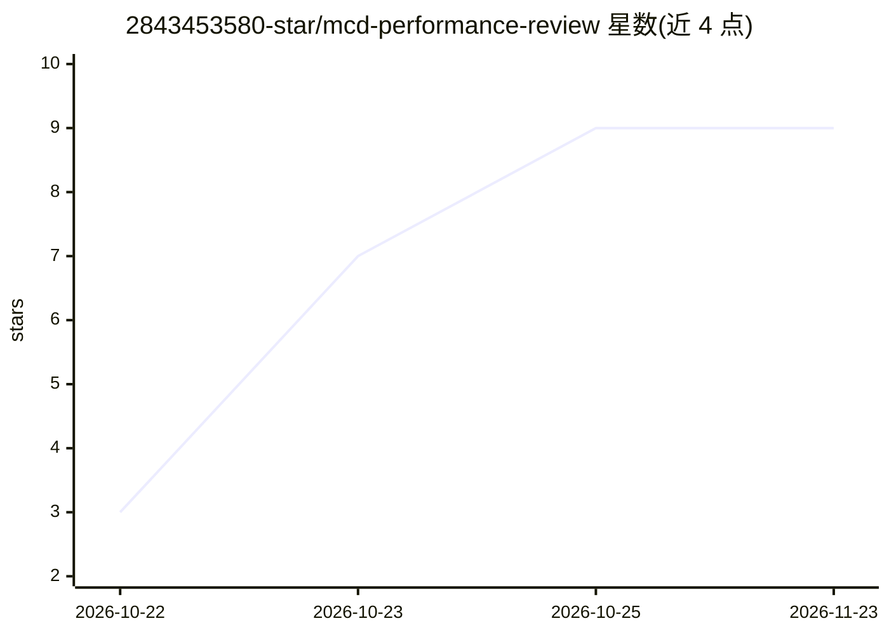

# 2843453580-star/mcd-performance-review

⭐ 9 · JavaScript · MIT · 推送 2026-10-20 · [GitHub](https://github.com/2843453580-star/mcd-performance-review) · [官网](https://2843453580-star.github.io/mcd-performance-review/) · 个人维护 · 中文 README

**给麦当劳用户：用真实订单生成年度绩效述职与颁奖**

以 WorkBuddy 技能和命令行两种形式提供的麦当劳订单年度总结工具：通过麦当劳 MCP 接口（order-list、query-my-account、query-meals）读取历史订单、积分与门店菜单，本地聚合客单价、复购频率、时段与城市轨迹后，用确定性规则引擎生成绩效评级、人设标签、毒舌点评、年度奖项及省钱/效率/积分止损建议。Node 零依赖；评级与点评基于规则而非大模型生成。需申请麦当劳 MCP Token，非麦当劳官方产品。

## 筛选速览

| 维度 | 判定 | 备注 |
|---|---|---|
| AI 角色 | `ai-native` | 本体是模型或模型工具 |
| 许可风险 | `permissive` | MIT |
| 部署形态 | `None` |  |
| 模型依赖 | — | README 未给出锁定关系 |
| 硬件要求 | — | 无带数字的原话,不猜 |
| 安装摩擦 | `low` | 无编译、无系统依赖或容器化 |
| 成熟度 | — | 结构信号不足 |

## 能力要点

- 通过麦当劳 MCP 实时读取订单、积分与菜单数据
- 规则引擎生成 S/A/B/C+/C-/D 评级与人设标签
- 基于订单数据触发年度奖项（如随心配占比≥40% 得年度最抠门奖）
- 提供网页在线预览，无需 Token 即可演示

## 适用场景

- 给自己生成一份可转发的麦门年度述职报告
- 查积分过期情况并获取止损提醒
- 根据真实订单数据获取省钱点单建议

## 场景标签

`数据分析` · 领域:效率与自动化

## 证据(README 行号)

> L49: 1. **查你的底**：`order-list` 拉历史订单（金额、门店、时间、城市），`query-my-account` 拉积分；
> L51: 3. **给你评级、发奖**：规则引擎生成人设标签、绩效评级、毒舌点评、年度奖项；
> L54: 全程零依赖，金额与画像来自 MCP 实时数据，评级与点评是确定性的规则（不靠大模型胡编）。

## 星数曲线

2026-10-22 3 → 2026-11-23 9（+6）

---
*卡片 v1 · prompt 1.4 · 生成 2026-11-20 · 置信度 high · 依据 README sha `66e73f5521df` · [字段定义](../../DATASET.md)*
