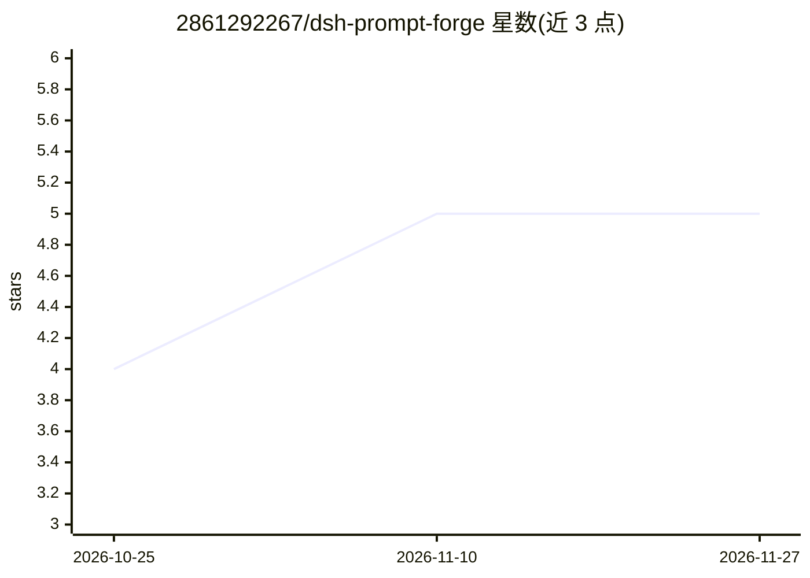

# 2861292267/dsh-prompt-forge

⭐ — · [GitHub]() · 个人维护 · 中文 README

**DeepSeek Harness 插件：一键把草稿改写成结构完整的提示词**

把 WorkBuddy 的「增强提示词」功能移植为 DeepSeek Harness 原生插件：读取输入框草稿，调用宿主 LLM 服务按四种预设风格（default/expand/concise/structured）改写后写回输入框，支持斜杠命令、一键取消与恢复原文。提示词模板逐字提取自 WorkBuddy 的 app.asar 并用测试锁定一致性；采用 cordis 插件体系、Standard Schema 配置与双路径路由挂载。依赖宿主环境提供 webserver 与 llm 服务，provider 必须显式配置。

## 筛选速览

| 维度 | 判定 | 备注 |
|---|---|---|
| AI 角色 | `ai-native` | 本体是模型或模型工具 |
| 许可风险 | `permissive` | — |
| 部署形态 | `desktop` | 安装包/桌面程序 |
| 模型依赖 | — | README 未给出锁定关系 |
| 硬件要求 | — | 无带数字的原话,不猜 |
| 安装摩擦 | `low` | 无编译、无系统依赖或容器化 |
| 成熟度 | — | 结构信号不足 |

## 能力要点

- 一键改写草稿并写回输入框，支持取消与恢复原文
- 四种预设风格，可自定义追加 styles 无需改代码
- 提示词模板与 WorkBuddy 原文做全等比较的测试锁定
- 自带启动日志与 HTTP 路由探测用于排障

## 适用场景

- 在 DeepSeek Harness 里把随手写的草稿一键改写成结构化提示词
- 为输入框追加自定义改写风格
- 参照其排障记录排查 DSH 插件不激活的问题

## 场景标签

`提示工程` · 领域:Agent 开发

## 证据(README 行号)

> L5: 在输入框旁边点一下，把你随手写的草稿改写成结构完整、要求明确的提示词，再自动写回输入框。
> L17: |**一键改写**|读取当前草稿 → 调模型改写 → 写回输入框|
> L198: |`provider`|`workbuddy-xdpool`|改写用的 provider 路由|

## 星数曲线

2026-10-25 4 → 2026-11-27 5（+1）

---
*卡片 v1 · prompt 1.4 · 生成 2026-11-21 · 置信度 high · 依据 README sha `53192559e688` · [字段定义](../../DATASET.md)*
