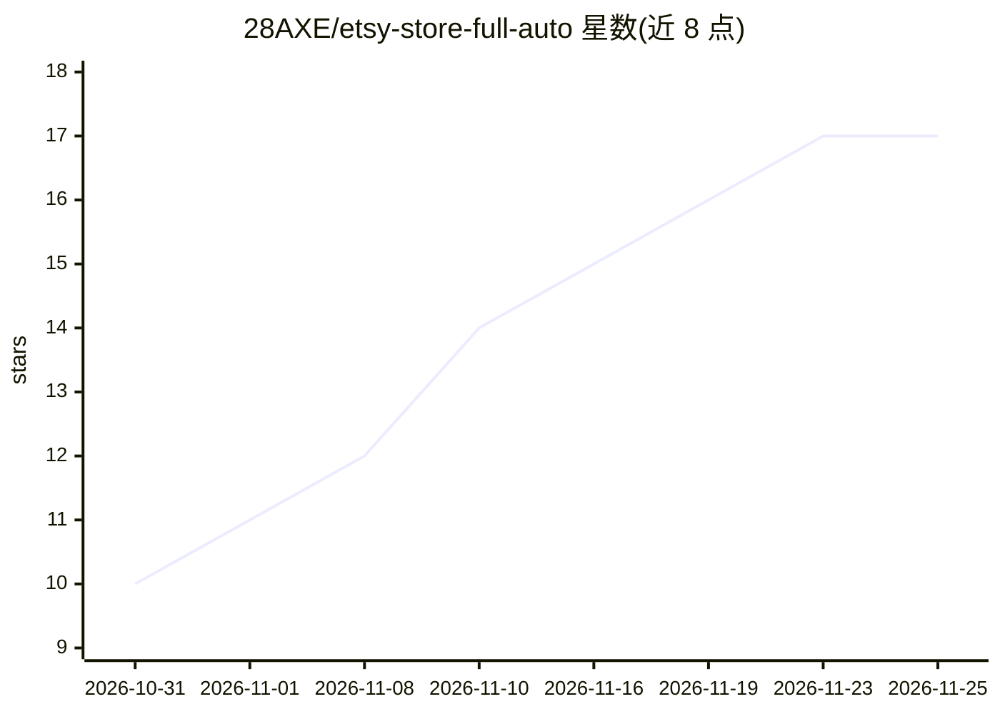

# 28AXE/etsy-store-full-auto

⭐ 17 · Python · 推送 2026-05-09 · [GitHub](https://github.com/28AXE/etsy-store-full-auto) · 个人维护

**Etsy 数字产品多 agent 自动化系统：抓取→分析→生成 PDF→追踪**

面向 Etsy 数字产品卖家的多 agent 系统，由 4 个 agent 组成：Scout 用 Playwright 抓取 Etsy 店铺 listing 数据，Analyst 用 pandas 结合 llm-council 多 LLM 商议识别市场机会与空白，Creator 生成产品内容与 PDF（reportlab），Optimizer 追踪表现并给出改进建议；每个 agent 各自配有 llm-council 做多模型商议。依赖 Python 3.10+、uv、Ollama 本地 LLM 与 Playwright 浏览器，通过 uv 命令安装运行。

## 筛选速览

| 维度 | 判定 | 备注 |
|---|---|---|
| AI 角色 | `ai-native` | 本体是模型或模型工具 |
| 许可风险 | `permissive` | — |
| 部署形态 | `None` |  |
| 模型依赖 | local-ok | 支持本地模型 |
| 硬件要求 | — | 无带数字的原话,不猜 |
| 安装摩擦 | `low` | 无编译、无系统依赖或容器化 |
| 成熟度 | — | 结构信号不足 |

## 能力要点

- 4 个分工 agent（抓取/分析/生成/优化）流水线协作
- 每个 agent 配 llm-council 进行多 LLM 商议
- Playwright 抓取 Etsy 店铺数据，reportlab 生成 PDF

## 适用场景

- 自动化调研 Etsy 数字产品的市场空白
- 批量生成可售卖的 PDF 数字产品内容
- 追踪已上架产品表现并获取改进建议

## 场景标签

`多智能体` `网页抓取` · 领域:Agent 开发

## 证据(README 行号)

> L9:  🤖 Autonomous multi-agent AI system for Etsy digital products
> L14: 4 agents, each with its own llm-council for multi-LLM deliberation:

## 星数曲线

2026-10-31 10 → 2026-11-25 17（+7）

---
*卡片 v1 · prompt 1.4 · 生成 2026-11-18 · 置信度 high · 依据 README sha `e6960ac550ad` · [字段定义](../../DATASET.md)*
