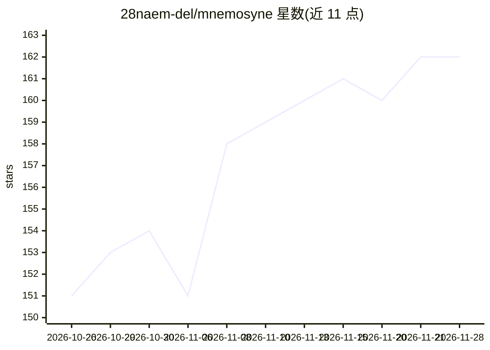

# 28naem-del/mnemosyne

⭐ 162 · TypeScript · MIT · 推送 2026-11-24 · [GitHub](https://github.com/28naem-del/mnemosyne) · [官网](https://mnemosy.ai) · 个人维护

**AI agent 的本地可审计长期记忆库，单 SQLite 文件**

为 AI agent 提供本地优先的长期记忆：单个 SQLite 文件保存 agent 学到的内容及其来源证据，通过 MCP、TypeScript SDK、CLI 或 HTTP 提供给宿主。每条记忆记录来源与信任级别，源修正时自动退役依赖它的记忆，支持历史回放与 bisect 定位失效记录。本地引擎无需模型 API key、数据库服务器或 Docker，要求 Node.js ≥22.16。面向使用 Claude Code、Cursor、Codex 等 MCP 宿主的开发者。

## 筛选速览

| 维度 | 判定 | 备注 |
|---|---|---|
| AI 角色 | `ai-ecosystem` | LLM/agent 周边工具 |
| 许可风险 | `permissive` | MIT |
| 部署形态 | `library` | 以包/库形式分发 |
| 模型依赖 | — | README 未给出锁定关系 |
| 硬件要求 | — | 无带数字的原话,不猜 |
| 安装摩擦 | `low` | 无编译、无系统依赖或容器化 |
| 成熟度 | — | 结构信号不足 |

## 能力要点

- 每条记忆携带来源与信任级别，修正后旧版本仍可查看
- 修正可传播：依赖被更正前提的过程与技能自动退役
- bisect 命令定位把正确答案挤出检索结果的记录
- 同一 SQLite 文件支持 MCP、TypeScript SDK、CLI、HTTP 四种接入方式

## 适用场景

- 让 Claude Code 或 Cursor 跨会话保留项目经验
- 需要可审计、可回放的记忆存储的 agent 系统
- 修正文档后自动清理基于旧前提的 agent 技能

## 场景标签

`Agent 记忆` `编码 Agent` · 领域:Agent 开发

## 证据(README 行号)

> L23: **Mnemosyne is local-first, long-term memory for AI agents: one SQLite file that keeps what an agent learned togeth
> L28: - **Any host.** MCP for Claude Code, Cursor and Codex; a TypeScript SDK; a CLI; and authenticated HTTP with a Pytho

## 星数曲线

2026-10-26 151 → 2026-11-28 162（+11）

---
*卡片 v1 · prompt 1.4 · 生成 2026-11-27 · 置信度 mid · 依据 README sha `ef9b033c413e` · [字段定义](../../DATASET.md)*
