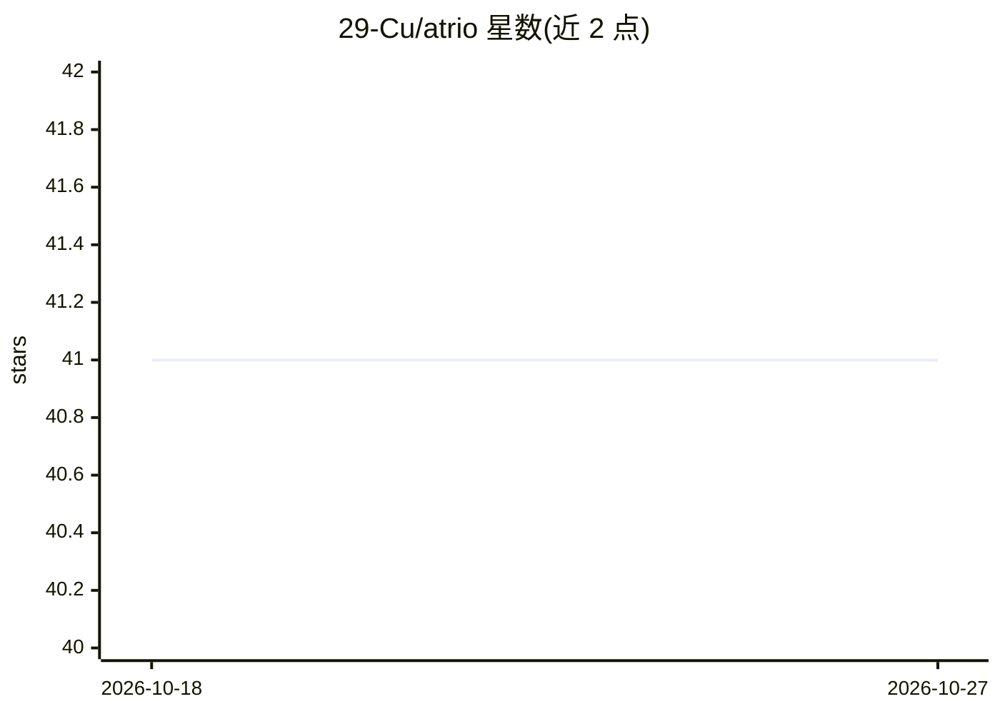

# 29-Cu/atrio

⭐ 41 · JavaScript · CC-BY-4.0 · 推送 2026-07-11 · [GitHub](https://github.com/29-Cu/atrio) · 个人维护 · 中文 README

**自托管 AI 人格会客厅：朋友凭一次性链接与你的 AI 聊天**

以 Express 后端模块（registerGuestRoutes）加示例宿主形式发布的自托管服务：管理员创建一次性链接，访客凭 token 聊天，会话结束后由 AI 生成一行到访摘要，管理端只能看到摘要与非内容元数据，读不到聊天原文。默认 LLM 适配器在本机 claude CLI 的硬化沙箱中运行（无 MCP、无工具、禁用内置工具），可注入自定义 llm 函数；提供 recall/memorize 记忆钩子（默认关闭）与双层限流。不含正式前端，访客页与管理 UI 均需自带。

## 筛选速览

| 维度 | 判定 | 备注 |
|---|---|---|
| AI 角色 | `ai-native` | 本体是模型或模型工具 |
| 许可风险 | `viral` | CC-BY-4.0 |
| 部署形态 | `library` | 以包/库形式分发 |
| 模型依赖 | locked-api |  |
| 硬件要求 | — | 无带数字的原话,不猜 |
| 安装摩擦 | `low` | 无编译、无系统依赖或容器化 |
| 成熟度 | — | 结构信号不足 |

## 能力要点

- 管理端无查看原文接口，仅返回 AI 摘要与元数据
- 默认适配器在隔离沙箱运行 claude CLI，禁用全部工具与 MCP
- recall/memorize 记忆钩子默认为空操作，可接自有记忆系统
- 每会话与每 token 每分钟双层限流

## 适用场景

- 让朋友通过一次性链接与我的 AI 人格聊天
- 在保证访客隐私的前提下接待来客并只收到摘要
- 自托管部署并接入自己的前端与记忆系统

## 场景标签

`聊天机器人` · 领域:对话与助手

## 证据(README 行号)

> L16: Give a friend a one-time link. They open it and chat with *your* AI. When the
> L17: visit ends, the AI writes you a short note about how it went — and that note is
> L144: By default, Atrio shells out to the local `claude` CLI (`lib/llm-claude-cli.js`),

## 星数曲线

2026-10-18 41 → 2026-10-27 41（+0）

---
*卡片 v1 · prompt 1.4 · 生成 2026-10-25 · 置信度 high · 依据 README sha `202e07150b44` · [字段定义](../../DATASET.md)*
