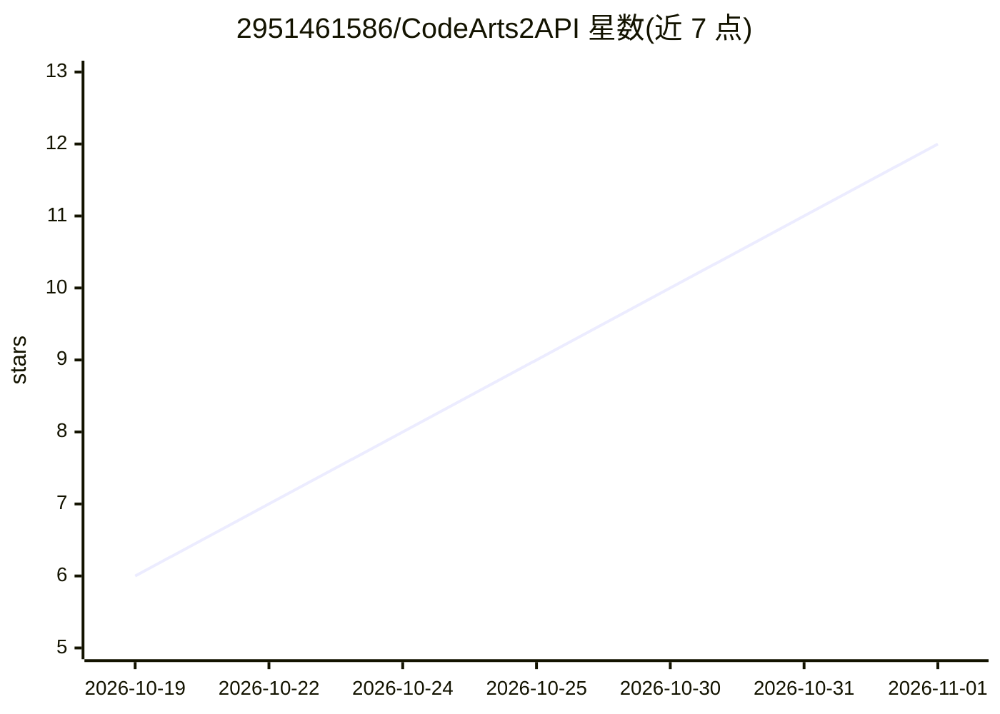

# 2951461586/CodeArts2API

⭐ 12 · Go · Apache-2.0 · 推送 2026-10-22 · [GitHub](https://github.com/2951461586/CodeArts2API) · 个人维护 · 中文 README

**把华为云 CodeArts Agent 上游复刻为 OpenAI/Anthropic 兼容网关的 Go 工具**

面向已登录华为云 CodeArts Agent（桌面端）的用户，用 Go 纯标准库实现单文件网关，将上游模型服务逆向复刻为 /v1/chat/completions（OpenAI）与 /v1/messages（Anthropic）双协议接口，含思维链与工具调用。凭据复用桌面端登录态（DPAPI 解密 state.vscdb 自动导入），也支持浏览器 OAuth 登录或手工录入 IAM AK/SK，STS 凭据可自动续期并回写。当前仅积分计费通道（免费通道已于 2026-10 下线），所有模型真实扣费，每账号 3 并发会话，附内嵌 Web 控制台管理账号池、密钥与模型别名。逆向复刻上游协议，使用需自行评估合规风险。

## 筛选速览

| 维度 | 判定 | 备注 |
|---|---|---|
| AI 角色 | `ai-ecosystem` | LLM/agent 周边工具 |
| 许可风险 | `permissive` | Apache-2.0 |
| 部署形态 | `desktop` | 安装包/桌面程序 |
| 模型依赖 | — | README 未给出锁定关系 |
| 硬件要求 | — | 无带数字的原话,不猜 |
| 安装摩擦 | `low` | 无编译、无系统依赖或容器化 |
| 成熟度 | — | 结构信号不足 |

## 能力要点

- OpenAI + Anthropic 双协议接口，含流式/工具调用/thinking 映射
- 三种凭据来源：桌面端登录态自动导入 / 浏览器 OAuth / 手工录入
- 纯 Go 标准库单文件约 10 MB，零外部依赖，自实现 SQLite 只读解析
- 内嵌 Web 控制台：账号池轮询换号、密钥签发、限流、活动福利自动领取

## 适用场景

- 用现有 CodeArts 订阅在任意 OpenAI/Anthropic SDK 客户端里调用模型
- 把 CodeArts 模型接入本地 IDE 插件等仅支持标准 API 的工具
- 多账号池轮询应对每账号 3 并发会话限制

## 场景标签

`模型网关` · 领域:Agent 开发

## 证据(README 行号)

> L3: 把本机 **CodeArts Agent**（华为云码道 / CodeArts Doer for Coding）桌面端的
> L4: 上游模型服务，逆向复刻成一个 **OpenAI 兼容的 Go 网关**。
> L12: - 🔌 **双协议** —— `/v1/chat/completions`（OpenAI）+ `/v1/messages`（Anthropic），含思维链与工具调用

## 星数曲线

2026-10-19 6 → 2026-11-01 12（+6）

---
*卡片 v1 · prompt 1.4 · 生成 2026-11-01 · 置信度 high · 依据 README sha `f525784432fe` · [字段定义](../../DATASET.md)*
