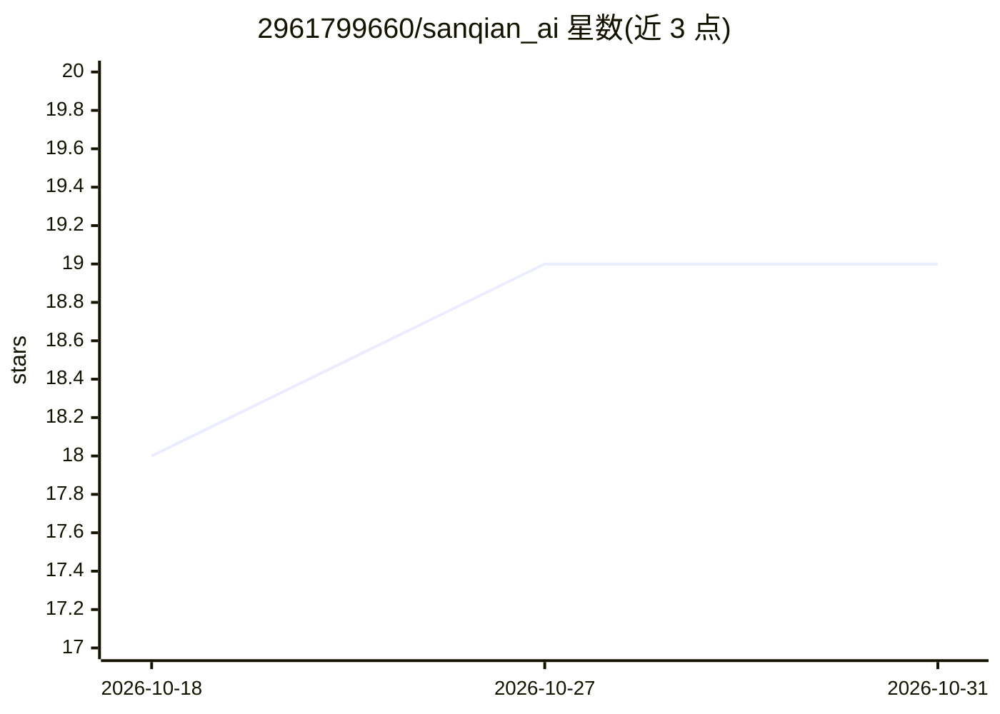

# 2961799660/sanqian_ai

⭐ 19 · TypeScript · NOASSERTION · 推送 2026-09-24 · [GitHub](https://github.com/2961799660/sanqian_ai) · [官网](https://ai.sanqianai.cn) · 组织维护 · 中文 README

**面向自媒体与内容团队的一站式 AI 工作台**

三千AI智能体是面向自媒体创作者、MCN 机构与内容团队的一站式 AIGC 工作台，提供多模型聚合对话（17 家供应商）、AI 无限画布节点工作流（20+ 内置节点）、口播 IP 运营 SOP、文生图/文生视频、数字人合成、AI 音乐、AI PPT、短漫剧生成与作品广场。技术栈为 Nuxt 4 + NestJS + PostgreSQL/pgvector，Docker Compose 部署，PC 与 H5 双端适配。采取 SaaS + 私有化授权（¥1380 起）+ 源码买断（¥6800）的付费模式，模型 API 费用与密钥由使用者自行配置承担。

## 筛选速览

| 维度 | 判定 | 备注 |
|---|---|---|
| AI 角色 | `ai-native` | 本体是模型或模型工具 |
| 许可风险 | `none` | NOASSERTION |
| 部署形态 | `self-host` | docker 或自建部署 |
| 模型依赖 | — | README 未给出锁定关系 |
| 硬件要求 | — | 无带数字的原话,不猜 |
| 安装摩擦 | `low` | 无编译、无系统依赖或容器化 |
| 成熟度 | — | 结构信号不足 |

## 能力要点

- 聚合 17 家模型供应商，同一对话框切换 LLM/生图/生视频模型
- AI 无限画布：文本/图片/视频/音频节点连线组织创作流程，ZIP/CROSS 批量模式
- 口播IP工作台：定位→选题→脚本→数据复盘闭环，覆盖 16 个领域
- 内置 6 个 MCP 工具（飞书/Notion/EXA/TikHub/小红书/Skillmaster），可自定义扩展

## 适用场景

- 自媒体团队批量生产口播脚本与数字人视频
- MCN 机构多账号矩阵运营与数据回流复盘
- 创业者买授权换品牌做 AI 工具变现或代理
- 企业私有化部署内部 AI 平台并接入飞书/Notion 工作流

## 场景标签

`工作流自动化` `图像生成` `视频生成` `AI 写作` · 领域:效率与自动化

## 证据(README 行号)

> L22: 三千AI智能体（Sanqian AI）是面向自媒体创作者、MCN 机构与内容团队的一站式 AI 工作台，官网 https://ai.sanqianai.cn 。一个账号即可集成 OpenAI、Gemini、Claude、豆包、Ki
> L145: **三千AI智能体是一款面向自媒体和内容团队的一站式 AI 工作台。一个账号集成 OpenAI、Gemini、Claude、豆包、Kimi、Qwen 等顶级模型,支持智能对话、图片生成、视频创作、画布工作台、口播 IP 工作台等

## 星数曲线

2026-10-18 18 → 2026-10-31 19（+1）

---
*卡片 v1 · prompt 1.4 · 生成 2026-10-29 · 置信度 high · 依据 README sha `bab4cf1ac52f` · [字段定义](../../DATASET.md)*
