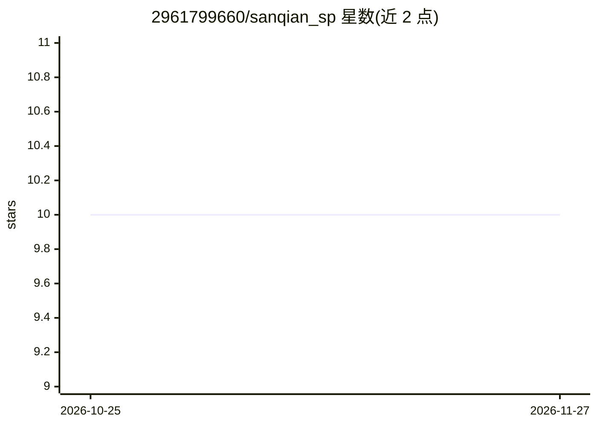

# 2961799660/sanqian_sp

⭐ 10 · 推送 2026-06-04 · [GitHub](https://github.com/2961799660/sanqian_sp) · [官网](https://sp.zijie.lol/) · 组织维护 · 中文 README

**给电商从业者从商品图/一句话生成带货短视频的 SaaS 工作台**

面向电商代运营、MCN 矩阵号、品牌方电商团队与小卖家的云端 AI 视频工作台。提供双模块：电商带货模块输入商品名与主图，端到端生成脚本、分镜、数字人口播与素材匹配的带货视频；智能视频模块输入一句话生成 9:16 短视频。内置自研 V1 多模态视频引擎、11 种中文音色 TTS、唇形同步数字人与版权素材库，附带电池计费的管理后台。本仓库仅存放产品文档，不含源码，产品以 SaaS 演示站与付费授权方式提供。

## 筛选速览

| 维度 | 判定 | 备注 |
|---|---|---|
| AI 角色 | `ai-native` | 本体是模型或模型工具 |
| 许可风险 | `none` | — |
| 部署形态 | `None` |  |
| 模型依赖 | — | README 未给出锁定关系 |
| 硬件要求 | — | 无带数字的原话,不猜 |
| 安装摩擦 | `low` | 无编译、无系统依赖或容器化 |
| 成熟度 | — | 结构信号不足 |

## 能力要点

- 电商带货模块：商品名+主图端到端生成带货视频，支持有模特/无模特两种模式
- 智能视频模块：一句话文生视频或复刻参考视频风格，含 16 个赛道模板
- 内置 11 种中文音色 TTS、商用数字人与唇形同步
- 管理后台含套餐编辑与按 req_key 配置的火山单价加价计费

## 适用场景

- 每天批量生成单 SKU 带货视频并上传抖音/视频号
- MCN 多矩阵号同一商品做差异化铺货
- 小商家用数字人替代真人出镜口播
- 节日营销批量出不同品类营销片

## 场景标签

`语音合成` `视频生成` · 领域:内容生成

## 证据(README 行号)

> L23: **三千AI电商工作台是一款专为电商代运营、MCN 矩阵、品牌方电商团队、小卖家打造的"够用的" AI 视频工作台。商品图、模特图、参考视频输入,最快 60 秒出片 —— Agent 端到端,自带商用数字人 + 11 种中文音色 
> L273: 本仓库**仅用于产品文档展示**,存放产品介绍、快速上手、计费机制、FAQ、示例 Prompt 库,**不包含产品源码**。
> L275: 三千AI电商工作台是云端 SaaS 产品,使用方式见 <https://sp.zijie.lol/>。

## 星数曲线

2026-10-25 10 → 2026-11-27 10（+0）

---
*卡片 v1 · prompt 1.4 · 生成 2026-11-20 · 置信度 high · 依据 README sha `562582d764c3` · [字段定义](../../DATASET.md)*
