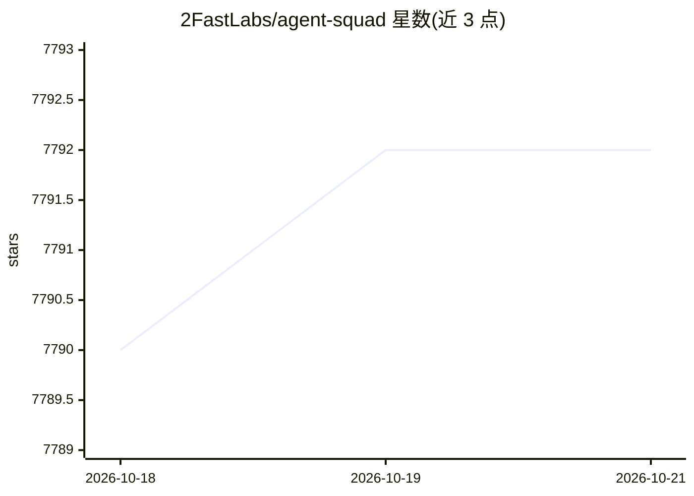

# 2FastLabs/agent-squad

⭐ 7,792 · Python · Apache-2.0 · 推送 2026-10-08 · [GitHub](https://github.com/2FastLabs/agent-squad) · [官网](https://2fastlabs.github.io/agent-squad/) · 组织维护

**多 AI agent 编排框架：路由查询至专属 agent 并维护上下文**

Agent Squad 是一个多 agent 编排开源框架，提供 Python、TypeScript 和 Swift 三种运行时。核心机制：Classifier 依据 agent 描述与对话历史，把每条用户查询路由给最合适的专属 agent，Orchestrator 保存交互记录并保持跨 agent 的上下文连贯。内置 Bedrock、Anthropic、OpenAI 等 agent，支持自定义 agent、分类器与存储。新增 JevClassifier（决策模型路由）、SupervisorAgent（并行团队协调）、GroundedAgent（双 LLM 抗幻觉模式）与 Swift 端上运行时。面向构建多 agent 应用的开发者。

## 筛选速览

| 维度 | 判定 | 备注 |
|---|---|---|
| AI 角色 | `ai-ecosystem` | LLM/agent 周边工具 |
| 许可风险 | `permissive` | Apache-2.0 |
| 部署形态 | `library` | 以包/库形式分发 |
| 模型依赖 | locked-api |  |
| 硬件要求 | — | 无带数字的原话,不猜 |
| 安装摩擦 | `low` | 无编译、无系统依赖或容器化 |
| 成熟度 | — | 结构信号不足 |

## 能力要点

- Classifier 意图分类路由查询至最合适 agent，跨 agent 维护对话上下文
- Python/TypeScript/Swift 三运行时，Swift 版全程端上运行（含 MCP 工具与实时语音）
- JevClassifier 用决策模型替代 LLM 路由，亚秒决策与校准置信度
- SupervisorAgent 并行子 agent 协调；GroundedAgent 隔离呈现层抗幻觉

## 适用场景

- 搭建多领域客服机器人并按意图自动路由
- 在 iPhone/Mac 上离线运行多 agent 编排与语音对话
- 需要答案严格贴合数据（价格/库存）的接地问答场景

## 场景标签

`多智能体` · 领域:Agent 开发

## 证据(README 行号)

> L2:  Flexible, lightweight open-source framework for orchestrating multiple AI agents — in the cloud with Python and Typ
> L25: Agent Squad routes each user query to the most suitable of your specialized agents and maintains conversation conte
> L47: 1. User input is analyzed by a **Classifier**.

## 星数曲线

2026-10-18 7,790 → 2026-10-21 7,792（+2）

---
*卡片 v1 · prompt 1.4 · 生成 2026-10-20 · 置信度 high · 依据 README sha `0e3cb4859ee1` · [字段定义](../../DATASET.md)*
