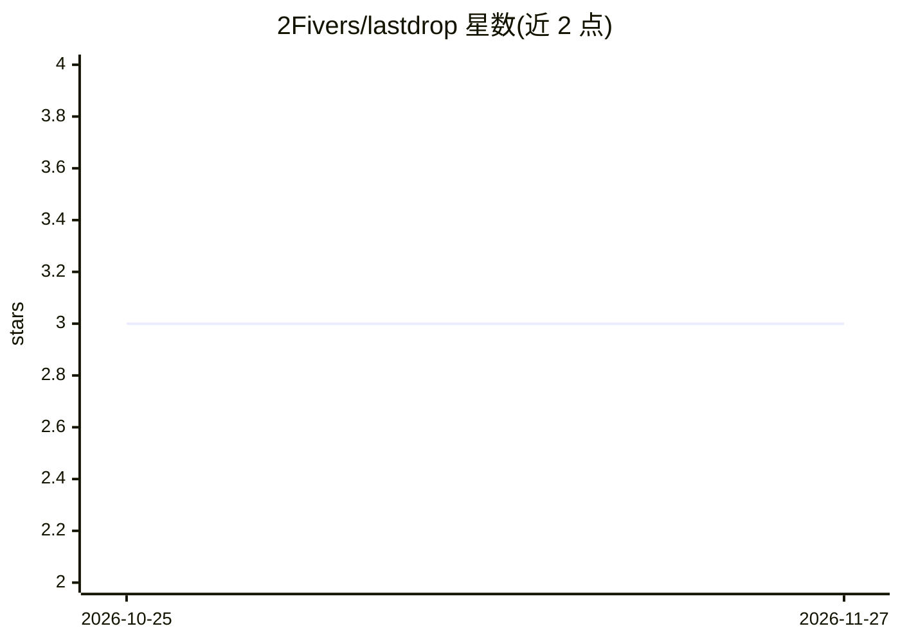

# 2Fivers/lastdrop

⭐ 3 · Rust · Apache-2.0 · 推送 2026-11-24 · [GitHub](https://github.com/2Fivers/lastdrop) · 组织维护

**Windows 11 托盘应用：一键查看各 AI 服务剩余用量**

面向订阅多个 AI 服务的用户，读取 Claude、Codex、GitHub Copilot、Cursor、Meshy 等服务的用量数据，在托盘图标与任务栏浮层中显示剩余额度、重置时间、近期消耗与按当前节奏能否撑到下次重置。提供 7/30/90 天用量历史图表与耗尽预测，限额达到 80%/95% 或重置时通知；Claude 与 Codex 支持多账号，并统计本地会话日志的 token 数与折算 API 价格。支持 JSON 扩展自定义余额服务，数据全部本地存储，界面提供五种语言。安装包尚未代码签名。

## 筛选速览

| 维度 | 判定 | 备注 |
|---|---|---|
| AI 角色 | `ai-ecosystem` | LLM/agent 周边工具 |
| 许可风险 | `permissive` | Apache-2.0 |
| 部署形态 | `desktop` | 安装包/桌面程序 |
| 模型依赖 | — | README 未给出锁定关系 |
| 硬件要求 | — | 无带数字的原话,不猜 |
| 安装摩擦 | `low` | 无编译、无系统依赖或容器化 |
| 成熟度 | `idea` | |

## 能力要点

- 托盘/任务栏浮层显示各服务剩余额度与重置时间
- 限额 80%/95% 与重置通知
- 7/30/90 天用量历史、消耗速率与耗尽预测图表
- JSON 文件描述余额端点即可扩展新服务，无需编译

## 适用场景

- 同时订阅多个 AI 服务时统一查看剩余额度
- 监控用量节奏，避免月中耗尽订阅额度
- 从本地会话日志统计 token 消耗并折算 API 成本

## 场景标签

`LLM 可观测性` · 领域:评测与运维

## 证据(README 行号)

> L5: Lastdrop is a Windows 11 tray app that shows your remaining usage across AI services —
> L17: - **Real statistics.** History, burn rate, pace and a forecast of when you run out.
> L34: accounts, one per config folder. Services with a simple balance or usage API are described in a

## 星数曲线

2026-10-25 3 → 2026-11-27 3（+0）

---
*卡片 v1 · prompt 1.4 · 生成 2026-11-22 · 置信度 mid · 依据 README sha `1b602b5b3493` · [字段定义](../../DATASET.md)*
