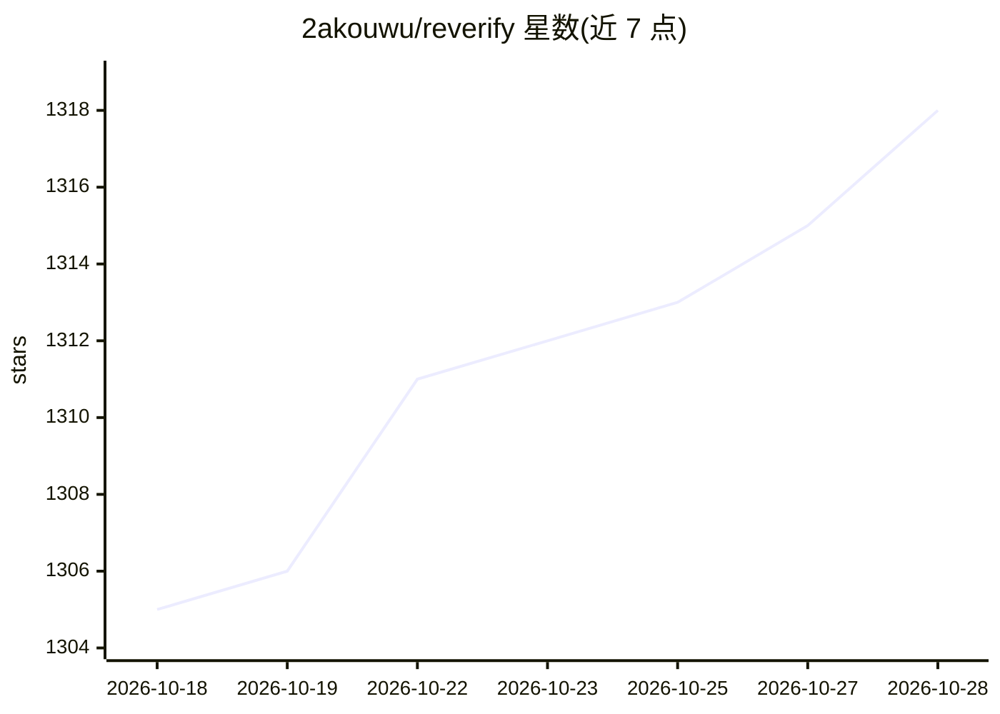

# 2akouwu/reverify

⭐ 1,318 · Python · MIT · 推送 2026-10-01 · [GitHub](https://github.com/2akouwu/reverify) · 个人维护

**让 AI 的逆向工程结论经确定性工具核验的 MCP 服务与 CLI**

面向使用 AI 做二进制逆向（也含普通源码等价性检查）的开发者的核验层：模型提出结构或行为声明，纯 Python 工具链（PE/ELF/Mach-O 解析、x86/x64/ARM/ARM64 反汇编、CPU 模拟、AOB 扫描等）将其与实际字节对照，返回 VERIFIED/REFUTED/INCONCLUSIVE 及证据；可选安装 capstone/unicorn/lief/Z3/angr 升级引擎。以 MCP 服务器 + CLI 形式提供，含按信息量加权的评分、跨上下文重置的 ledger 状态与多轮 fresh-session 编排（orchestrate）。限定授权逆向场景。

## 筛选速览

| 维度 | 判定 | 备注 |
|---|---|---|
| AI 角色 | `ai-ecosystem` | LLM/agent 周边工具 |
| 许可风险 | `permissive` | MIT |
| 部署形态 | `desktop` | 安装包/桌面程序 |
| 模型依赖 | — | README 未给出锁定关系 |
| 硬件要求 | — | 无带数字的原话,不猜 |
| 安装摩擦 | `low` | 无编译、无系统依赖或容器化 |
| 成熟度 | — | 结构信号不足 |

## 能力要点

- 声明→确定性工具核验→VERIFIED/REFUTED/INCONCLUSIVE 带证据的验证回路
- 纯 Python 核心可选升级 capstone/unicorn/lief/Z3/angr 引擎
- 按信息量加权（--min-information），平凡验证不计为 grounded
- ledger 按二进制 SHA-256 持久化已验证/已证伪事实，跨 compaction/clear 恢复
- MCP 服务器（re_verify_claim/re_ledger）+ CLI 双形态

## 适用场景

- 让 Claude Code/Cursor 等 agent 在逆向时只能报告经工具核验的结论
- CI 中对 AI 重建的结构/算法做门禁（任一声明被证伪即退出非零）
- 长任务跨上下文重置后从已验证事实恢复，不重复已证伪的猜测

## 场景标签

`网络安全` · 领域:学习与行业

## 证据(README 行号)

> L26:  truth, not trusted, and only what survives becomes a fact (`reverify verify`, or the MCP
> L70: - **Agent-native** — ships as an MCP server, so Claude Code, Cursor, and other agents can call

## 星数曲线

2026-10-18 1,305 → 2026-10-28 1,318（+13）

---
*卡片 v1 · prompt 1.4 · 生成 2026-10-21 · 置信度 mid · 依据 README sha `16bc9afda3f2` · [字段定义](../../DATASET.md)*
