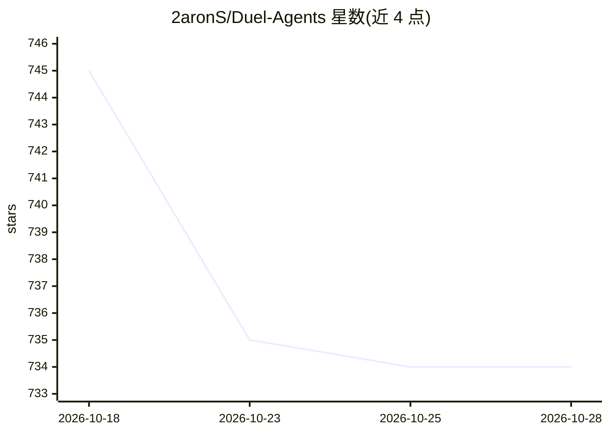

# 2aronS/Duel-Agents

⭐ 734 · TypeScript · MIT · 推送 2026-06-29 · [GitHub](https://github.com/2aronS/Duel-Agents) · [官网](https://duelagents.com) · 个人维护

**多模型路由代理的官方集成包：CLI/SDK/IDE 插件接入 Duel API**

duelagents.com 的官方集成仓库，提供将多个 IDE/CLI 工具（Claude Code、Cursor、Codex CLI、OpenClaw）的 LLM 流量路由到 https://duelagents.com/v1 的安装器与插件：向多个模型发送提示并选取成本最低的获胜回答。所有工具必须使用 Duel API key（duel_ 前缀格式），不能直接用 Anthropic/OpenAI 原始 key。另提供 TypeScript SDK（@duel-agents/sdk）与 LangChain/LlamaIndex 官方 Python 包，API 与 OpenAI wire 协议兼容。订阅与 key 管理在 dashboard 完成。

## 筛选速览

| 维度 | 判定 | 备注 |
|---|---|---|
| AI 角色 | `ai-ecosystem` | LLM/agent 周边工具 |
| 许可风险 | `permissive` | MIT |
| 部署形态 | `library` | 以包/库形式分发 |
| 模型依赖 | — | README 未给出锁定关系 |
| 硬件要求 | — | 无带数字的原话,不猜 |
| 安装摩擦 | `low` | 无编译、无系统依赖或容器化 |
| 成熟度 | — | 结构信号不足 |

## 能力要点

- npx 安装器一键接入 Claude Code / Cursor / Codex CLI / OpenClaw
- TypeScript SDK 与 LangChain-duel、llama-index-llms-duel Python 包
- OpenAI wire 兼容代理，可配合任意 OpenAI 兼容客户端
- 统一 Duel API key，路由到 duelagents.com/v1

## 适用场景

- 把现有 IDE/CLI 编码工具的模型后端切换到 Duel 路由服务
- 在自己的 agent/脚本中通过 SDK 调用 Duel 多模型路由
- 在 LangChain/LlamaIndex 项目中使用 duel-auto 模型

## 场景标签

`模型网关` · 领域:Agent 开发

## 证据(README 行号)

> L8: **Use, extend, and ship with Duel Agents**: the IDE-native routing layer that runs prompts against multiple models a
> L16: Every tool in this repo routes LLM traffic through **`https://duelagents.com/v1`** with a **Duel API key** (`duel_<

## 星数曲线

2026-10-18 745 → 2026-10-28 734（-11）

---
*卡片 v1 · prompt 1.4 · 生成 2026-10-22 · 置信度 high · 依据 README sha `a8c6ccbae2be` · [字段定义](../../DATASET.md)*
