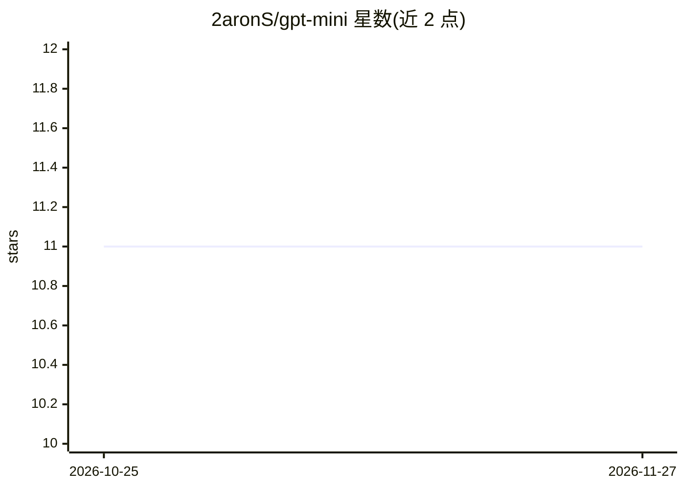

# 2aronS/gpt-mini

⭐ 11 · Rust · NOASSERTION · 推送 2026-05-19 · [GitHub](https://github.com/2aronS/gpt-mini) · 个人维护

**Rust 实现的极简 GPT transformer 学习库**

以 Rust 从零实现的 GPT 风格 transformer 教学库，无深度学习框架抽象。提供 GPTConfig（vocab_size/n_layer/n_head/n_embd/block_size 等架构配置）、GPT 模型（随机初始化/加载预训练权重/前向/生成）、BPE Tokenizer 与 Trainer 训练循环（支持从文本文件构建数据集、保存 checkpoint）。定位为学习 transformer 内部机制的工具，通过 cargo 安装。

## 筛选速览

| 维度 | 判定 | 备注 |
|---|---|---|
| AI 角色 | `ai-native` | 本体是模型或模型工具 |
| 许可风险 | `none` | NOASSERTION |
| 部署形态 | `None` |  |
| 模型依赖 | — | README 未给出锁定关系 |
| 硬件要求 | — | 无带数字的原话,不猜 |
| 安装摩擦 | `low` | 无编译、无系统依赖或容器化 |
| 成熟度 | — | 结构信号不足 |

## 能力要点

- 纯 Rust 实现的 GPT transformer，无框架抽象
- GPT/BPE Tokenizer/Trainer 四大组件 API
- 支持加载预训练权重与文本文件数据集训练
- 保存/恢复模型 checkpoint

## 适用场景

- 学习 transformer 内部机制
- 用 Rust 从头训练小型 GPT 模型
- 阅读源码理解 GPT 架构与训练循环

## 场景标签

`模型训练` `教程课程` · 领域:学习与行业

## 证据(README 行号)

> L8: > Pure Rust implementation of a minimal GPT transformer
> L10: A small, educational implementation of a GPT-style transformer in Rust. Good for learning how transformers work und

## 星数曲线

2026-10-25 11 → 2026-11-27 11（+0）

---
*卡片 v1 · prompt 1.4 · 生成 2026-11-19 · 置信度 high · 依据 README sha `88db0ce082d4` · [字段定义](../../DATASET.md)*
