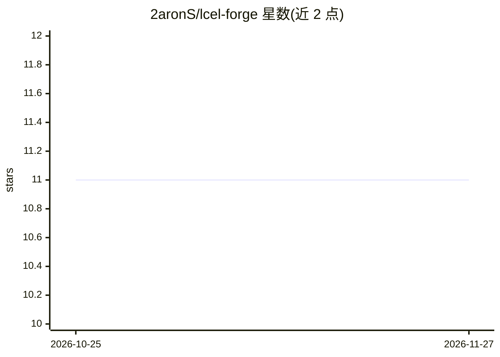

# 2aronS/lcel-forge

⭐ 11 · Jupyter Notebook · MIT · 推送 2026-05-19 · [GitHub](https://github.com/2aronS/lcel-forge) · 个人维护

**生成 LangChain LCEL 代码的 AI 代码生成工具**

以 Python 库形式提供的代码生成器，通过导入 LCELForge 类并初始化后调用，生成 LangChain Expression Language（LCEL）代码。README 内容简短，仅说明安装方式（pip）、基本用法示例和 MIT 许可，未展示生成流程细节、支持的链类型或输出格式。面向需要编写 LCEL 管道代码的开发者使用。

## 筛选速览

| 维度 | 判定 | 备注 |
|---|---|---|
| AI 角色 | `ai-native` | 本体是模型或模型工具 |
| 许可风险 | `permissive` | MIT |
| 部署形态 | `library` | 以包/库形式分发 |
| 模型依赖 | — | README 未给出锁定关系 |
| 硬件要求 | — | 无带数字的原话,不猜 |
| 安装摩擦 | `low` | 无编译、无系统依赖或容器化 |
| 成熟度 | — | 结构信号不足 |

## 能力要点

- 生成 LangChain Expression Language 代码
- 以 Python 库形式提供（from lcel_forge import LCELForge）
- pip 安装即可使用，MIT 许可

## 适用场景

- 为 LangChain 应用快速生成 LCEL 管道代码
- 不熟悉 LCEL 语法时借助 AI 生成链式调用代码

## 场景标签

`代码生成` · 领域:编码与开发

## 证据(README 行号)

> L3: AI developer that generates LangChain Expression Language code
> L14: from lcel_forge import LCELForge

## 星数曲线

2026-10-25 11 → 2026-11-27 11（+0）

---
*卡片 v1 · prompt 1.4 · 生成 2026-11-19 · 置信度 mid · 依据 README sha `5b181f9a7db5` · [字段定义](../../DATASET.md)*
