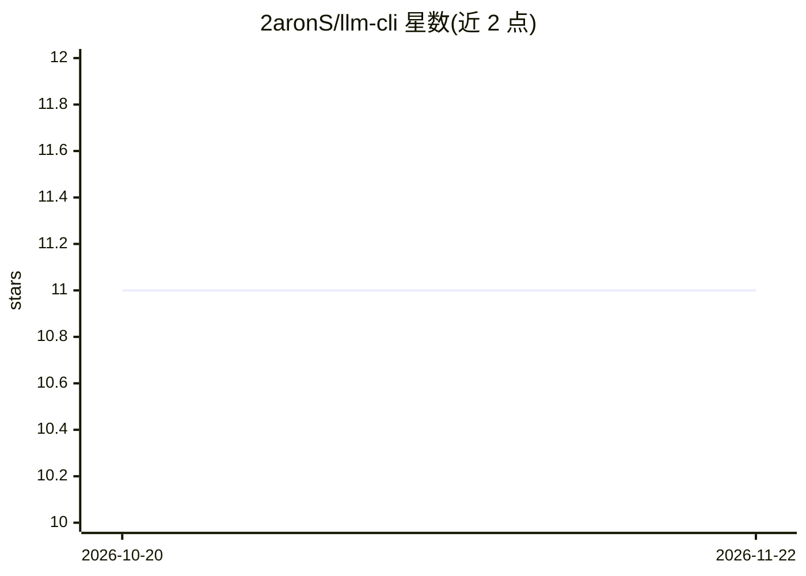

# 2aronS/llm-cli

⭐ 11 · Python · NOASSERTION · 推送 2026-05-19 · [GitHub](https://github.com/2aronS/llm-cli) · 个人维护

**命令行查询大语言模型的 Python CLI 工具**

以 pip 包形式分发的命令行工具，用户在终端输入提示词即可查询大语言模型并获取生成文本。提供模型选择、采样温度、最大回复长度、逐 token 流式输出、stdin/多行输入、system prompt 等命令行选项；支持环境变量与 ~/.llm-cli/config.json 配置文件持久化默认模型与 API key；README 列出支持的模型包括 OpenAI、Anthropic 及本地 Ollama。未提及桌面界面或图形功能。

## 筛选速览

| 维度 | 判定 | 备注 |
|---|---|---|
| AI 角色 | `ai-ecosystem` | LLM/agent 周边工具 |
| 许可风险 | `none` | NOASSERTION |
| 部署形态 | `library` | 以包/库形式分发 |
| 模型依赖 | local-ok | 支持本地模型 |
| 硬件要求 | — | 无带数字的原话,不猜 |
| 安装摩擦 | `low` | 无编译、无系统依赖或容器化 |
| 成熟度 | — | 结构信号不足 |

## 能力要点

- 单条命令直接向 LLM 发起查询
- --stream 逐 token 流式输出，--stdin/--multiline 支持多种输入方式
- 环境变量与 ~/.llm-cli/config.json 双通道持久化配置
- 支持 OpenAI、Anthropic 及本地 Ollama 模型

## 适用场景

- 在终端快速向大语言模型提问并获取回答
- 用脚本管道（stdin）把文本喂给 LLM 处理
- 配置文件固化默认模型与 API key 后日常调用

## 场景标签

`AI 助手` · 领域:对话与助手

## 证据(README 行号)

> L9: > Command-line interface for querying large language models
> L34: |`--model`, `-m`|model to use|`gpt-3.5-turbo`|
> L66: - OpenAI: `gpt-4`, `gpt-3.5-turbo`

## 星数曲线

2026-10-20 11 → 2026-11-22 11（+0）

---
*卡片 v1 · prompt 1.4 · 生成 2026-11-19 · 置信度 high · 依据 README sha `be2926d2e3a4` · [字段定义](../../DATASET.md)*
