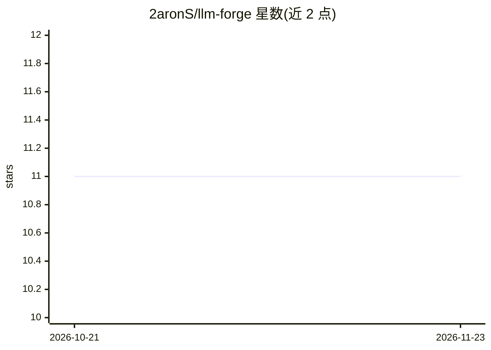

# 2aronS/llm-forge

⭐ 11 · MIT · 推送 2026-05-19 · [GitHub](https://github.com/2aronS/llm-forge) · 个人维护

**给开发者提供 LLM 应用的端到端部署流水线框架**

以 Python 库形式提供的 LLM 应用构建与部署工具：核心抽象为 Pipeline（编排预处理步骤、模型调用、监控与限流）和 Model（封装模型标识、采样温度、max_tokens、API key），支持单次运行与批量处理；提供 KubernetesDeployer、AWSDeployer、DockerDeployer 三种部署器，覆盖 k8s、ECS/EKS 与本地 docker-compose，统一支持滚动更新、健康监控、日志聚合和指标导出到 Prometheus，并可导出 terraform/helm/docker-compose 配置。

## 筛选速览

| 维度 | 判定 | 备注 |
|---|---|---|
| AI 角色 | `ai-ecosystem` | LLM/agent 周边工具 |
| 许可风险 | `permissive` | MIT |
| 部署形态 | `self-host` | docker 或自建部署 |
| 模型依赖 | — | README 未给出锁定关系 |
| 硬件要求 | — | 无带数字的原话,不猜 |
| 安装摩擦 | `low` | 无编译、无系统依赖或容器化 |
| 成熟度 | — | 结构信号不足 |

## 能力要点

- Pipeline 编排预处理、模型调用、监控与速率限制
- 三种部署器：Kubernetes、AWS（ECS/EKS）、Docker
- 部署器统一支持滚动更新、健康检查、日志聚合
- 可导出 terraform、helm 或 docker-compose 配置

## 适用场景

- 把 LLM 应用从代码推到 k8s 集群并带自动扩缩容
- 部署到 AWS ECS/EKS 并接入 CloudWatch
- 本地用 docker/compose 快速起一套流水线

## 场景标签

`MLOps` · 领域:训练与推理

## 证据(README 行号)

> L12: > Production-ready LLM applications with end-to-end deployment pipelines
> L41: Main orchestration object for your LLM application.
> L66: **KubernetesDeployer**: Deploy to k8s clusters with auto-scaling and health checks

## 星数曲线

2026-10-21 11 → 2026-11-23 11（+0）

---
*卡片 v1 · prompt 1.4 · 生成 2026-11-19 · 置信度 high · 依据 README sha `ea21219e582b` · [字段定义](../../DATASET.md)*
