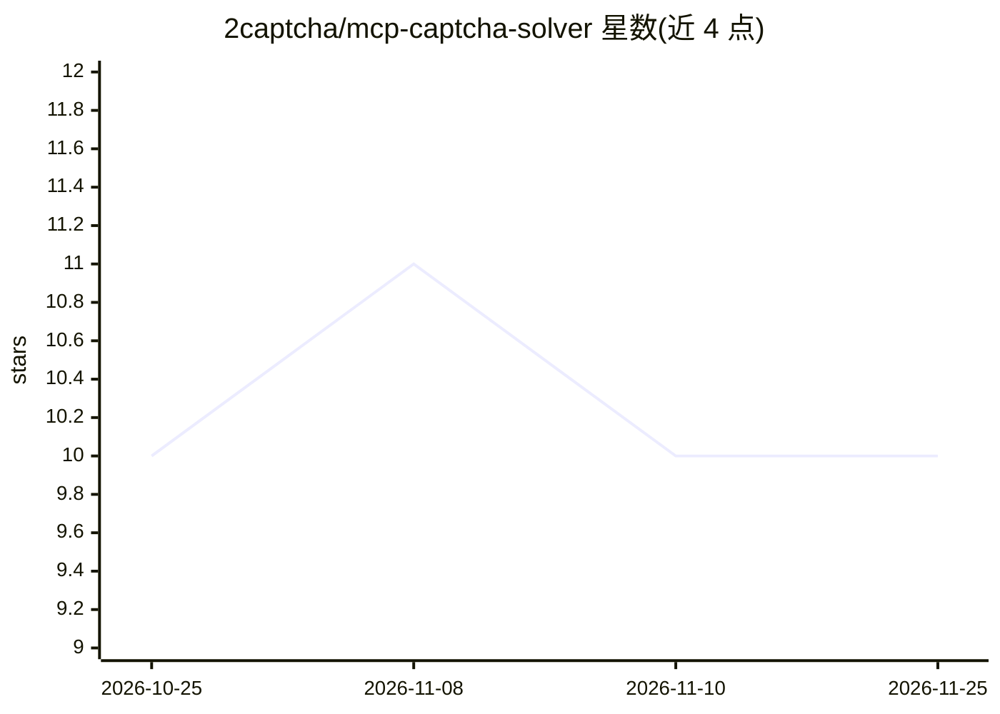

# 2captcha/mcp-captcha-solver

⭐ 10 · Python · MIT · 推送 2026-04-16 · [GitHub](https://github.com/2captcha/mcp-captcha-solver) · 组织维护

**面向 AI agent 的 MCP 验证码工具服务器：以专用工具处理 reCAPTCHA v2**

一个演示性质的 MCP 服务器，将浏览器自动化与验证码处理封装为 agent 可调用的工具：浏览器能力（打开页面、查找元素、点击、提取文本/JSON）与 reCAPTCHA v2 解题能力分层实现，底层经 Selenium 驱动本地 Chrome，结果以规范化 JSON 返回。依赖 Python 3.11+、Chrome、匹配版本的 ChromeDriver 及 2Captcha API key；可注册到 Claude Desktop 等 MCP 客户端进行 agent 流程测试。项目定位为文章配套的本地实验 demo，README 未提供打包发布渠道。

## 筛选速览

| 维度 | 判定 | 备注 |
|---|---|---|
| AI 角色 | `ai-ecosystem` | LLM/agent 周边工具 |
| 许可风险 | `permissive` | MIT |
| 部署形态 | `library` | 以包/库形式分发 |
| 模型依赖 | — | README 未给出锁定关系 |
| 硬件要求 | — | 无带数字的原话,不猜 |
| 安装摩擦 | `low` | 无编译、无系统依赖或容器化 |
| 成熟度 | `idea` | |

## 能力要点

- MCP 工具层与 Selenium 细节分离，agent 无需执行底层浏览器步骤
- 13 个工具：11 个通用浏览器工具加 captcha_solve_recaptcha_v2
- 工具返回规范化 JSON 结果，失败时含 message 与 screenshot_path
- 架构预留扩展其他挑战类型（如 Turnstile）的空间

## 适用场景

- 让 agent 在验证码阻断的网页流程中调用工具移除 reCAPTCHA v2
- 以 MCP 客户端编排浏览器自动化任务并保留中间截图
- 作为 MCP 加 Selenium 分层架构的本地学习/实验样板

## 场景标签

`浏览器自动化` · 领域:效率与自动化

## 证据(README 行号)

> L1: # MCP captcha solver for AI agents
> L51: - `mcp_server/server.py`: MCP tools that expose workflows to the agent
> L266: - `captcha_solve_recaptcha_v2`

## 星数曲线

2026-10-25 10 → 2026-11-25 10（+0）

---
*卡片 v1 · prompt 1.4 · 生成 2026-11-20 · 置信度 high · 依据 README sha `94af78ef4fa6` · [字段定义](../../DATASET.md)*
