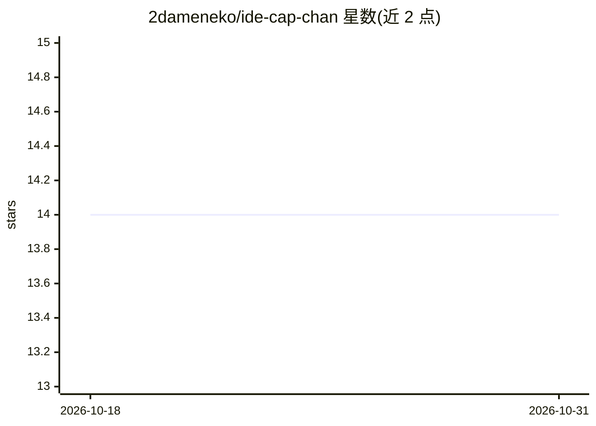

# 2dameneko/ide-cap-chan

⭐ 14 · Python · Apache-2.0 · 推送 2026-05-08 · [GitHub](https://github.com/2dameneko/ide-cap-chan) · [官网](https://github.com/2dameneko/ide-cap-chan) · 个人维护

**用多种视觉语言模型批量生成图片自然语言描述的工具**

面向需要为图片数据集批量生成自然语言描述（caption）的用户：支持 Idefics3、LLaVA、Qwen2-VL、Molmo、JoyCaption、Pixtral、MiniCPM-o 等多种 VL 模型架构，通过 CLI 指定模型与加载器（默认 ExLlama2），支持多 GPU 任务分发、exl2/int8/nf4 量化与 VRAM 优化加载，可结合已有 tag 文件增强描述，支持中断恢复与子目录递归处理。README 声明自 2026 起废弃，指向继任项目 gem-cap-chan 与 tor-cap-chan，且注明为概念验证、非生产就绪。需 NVIDIA GPU（最低 8GB VRAM）。

## 筛选速览

| 维度 | 判定 | 备注 |
|---|---|---|
| AI 角色 | `ai-native` | 本体是模型或模型工具 |
| 许可风险 | `permissive` | Apache-2.0 |
| 部署形态 | `library` | 以包/库形式分发 |
| 模型依赖 | — | README 未给出锁定关系 |
| 硬件要求 | `gpu-8g` | |
| 安装摩擦 | `medium` | 含编译或系统依赖之一 |
| 成熟度 | `idea` | |

## 能力要点

- 支持 idefics3/llava/joy-caption/molmo/qwen2vl/pixtral/minicpmo/exllama2 等多种模型加载器
- 多 GPU 任务分发与 exl2/int8/nf4 量化降低显存占用
- 可用已有 tag/角色信息（ToriiGate ≥0.4）增强描述
- 中断恢复与子目录递归批量处理

## 适用场景

- 为训练数据集批量生成图片自然语言描述
- 结合已有标签文件生成增强版描述
- 多 GPU 环境下批量处理大量图片

## 场景标签

`多模态` · 领域:感知与多模态

## 证据(README 行号)

> L5: ide-cap-chan is a utility for batch captioning images with natural language using various Vision-Language (VL) model
> L8: * **High-speed processing**: Optimized for rapid batch caption generation with ExLlama2, Qwen2-VL-7B-Instruct, Qwen2

## 星数曲线

2026-10-18 14 → 2026-10-31 14（+0）

---
*卡片 v1 · prompt 1.4 · 生成 2026-10-31 · 置信度 mid · 依据 README sha `3a7ddc4c2cc4` · [字段定义](../../DATASET.md)*
