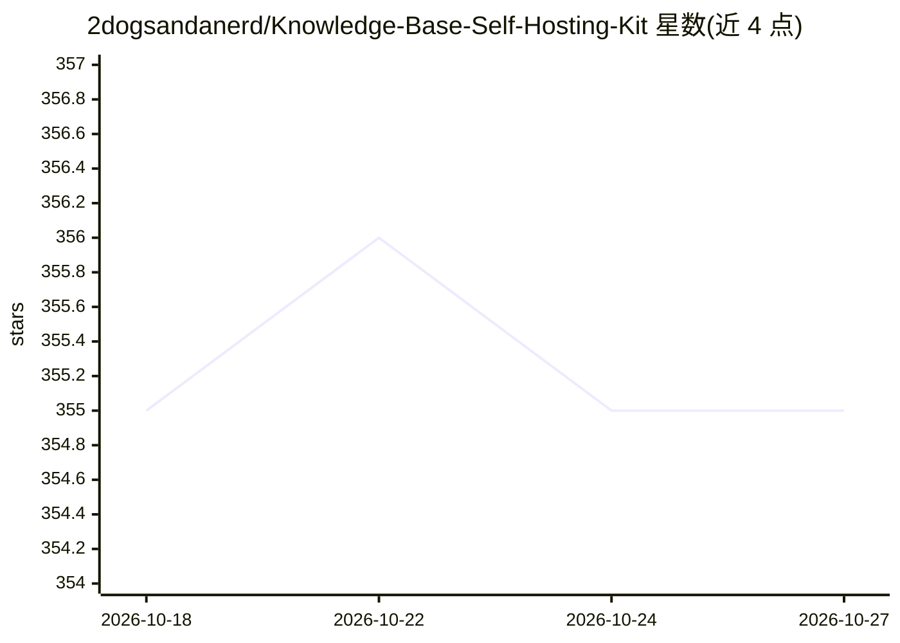

# 2dogsandanerd/Knowledge-Base-Self-Hosting-Kit

⭐ 355 · Python · NOASSERTION · 推送 2026-03-14 · [GitHub](https://github.com/2dogsandanerd/Knowledge-Base-Self-Hosting-Kit) · 个人维护

**自托管 RAG 知识库套件：本地摄取文档与代码并语义查询**

Docker Compose 部署的自托管 RAG 系统：通过 ChromaDB 与 Docling 摄取 PDF、Markdown 及代码仓库，支持向量+BM25 混合检索；FastAPI 后端提供集合管理、上传、摄取与查询 API，前端含仪表盘与 Agent 配置页。默认搭配宿主机 Ollama 模型（llama3/nomic-embed-text），也可经 OPENAI_BASE_URL 接 OpenAI 兼容服务。附带 MCP server 供 OpenClaw 等 MCP 客户端接入，LLM 提供商包括 openai/anthropic/gemini。README 首部含作者争议声明，称因他人冒名而可能停止开源维护。

## 筛选速览

| 维度 | 判定 | 备注 |
|---|---|---|
| AI 角色 | `ai-ecosystem` | LLM/agent 周边工具 |
| 许可风险 | `permissive` | NOASSERTION |
| 部署形态 | `self-host` | docker 或自建部署 |
| 模型依赖 | local-ok | 支持本地模型 |
| 硬件要求 | — | 无带数字的原话,不猜 |
| 安装摩擦 | `low` | 无编译、无系统依赖或容器化 |
| 成熟度 | — | 结构信号不足 |

## 能力要点

- 向量+BM25 混合分块检索并返回引用来源
- Docker Compose 一键部署，nginx 网关统一暴露服务
- 内置 MCP server 与 Agent Configuration 页面接入 MCP 客户端
- 默认 Ollama 本地模型，支持 OpenAI 兼容端点

## 适用场景

- 私有化摄取并检索自己的代码库与文档
- 为本地 LLM 或 agent 提供可自托管的知识记忆层
- 通过 MCP 让 OpenClaw 等客户端接入知识库查询

## 场景标签

`RAG` · 领域:知识与检索

## 证据(README 行号)

> L22: **A production-ready, self-hosted RAG memory layer that pairs with local LLMs, chains, and autonomous agents.**
> L49: - **Local LLM friendly:** default Ollama setup shares host models, but OpenAI-compatible servers are supported via 

## 星数曲线

2026-10-18 355 → 2026-10-27 355（+0）

---
*卡片 v1 · prompt 1.4 · 生成 2026-10-21 · 置信度 mid · 依据 README sha `f51a4c75608c` · [字段定义](../../DATASET.md)*
