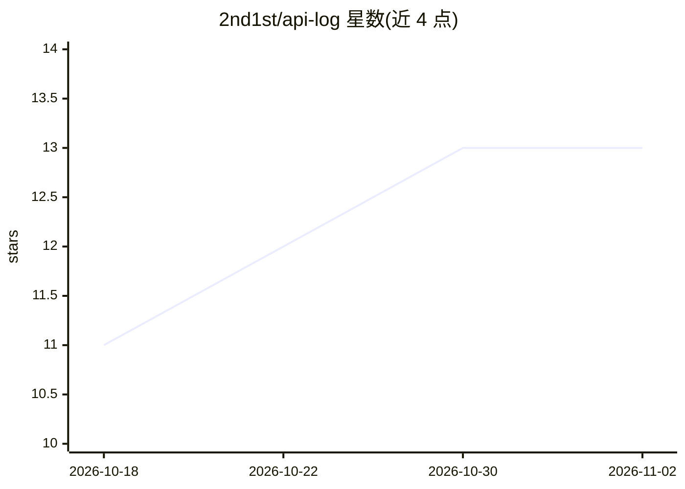

# 2nd1st/api-log

⭐ 13 · Go · MIT · 推送 2026-06-06 · [GitHub](https://github.com/2nd1st/api-log) · 个人维护 · 中文 README

**LLM 网关流量录制代理：透明记录并索引 OpenAI/Anthropic/Gemini trace**

透明 HTTP 录制代理，部署在 sub2api、CLIProxyAPI、new-api 等 OpenAI 兼容网关之前，原样转发流量并捕获 OpenAI Chat/Responses、Anthropic Messages、Gemini 协议。每条完成的请求/响应以 append-only JSONL 落盘并构建 SQLite 索引，支持本地检索、SSE 按原节奏重放和按 key 排查。转发过程不解析请求体，不做路由/计费/鉴权；token 统计与评测在其范围之外。提供 Docker Compose、发布二进制与源码构建三种安装方式。

## 筛选速览

| 维度 | 判定 | 备注 |
|---|---|---|
| AI 角色 | `ai-ecosystem` | LLM/agent 周边工具 |
| 许可风险 | `permissive` | MIT |
| 部署形态 | `self-host` | docker 或自建部署 |
| 模型依赖 | — | README 未给出锁定关系 |
| 硬件要求 | — | 无带数字的原话,不猜 |
| 安装摩擦 | `low` | 无编译、无系统依赖或容器化 |
| 成熟度 | `idea` | |

## 能力要点

- 捕获 OpenAI Chat/Responses、Anthropic Messages、Gemini 等协议的请求/响应 trace
- append-only JSONL 落盘 + SQLite 派生索引（可重建，冲突时以 JSONL 为准）
- SSE 流按原 per-chunk 节奏重放（replay 不回源上游）
- 独立读 API 与配套 viewer SPA（api-log-viewer）

## 适用场景

- 排查某个 API key 或会话的网关请求问题
- 录制并重放 LLM 网关的 SSE 流量用于调试
- 对网关流量做本地检索与按模型/状态过滤分析

## 场景标签

`LLM 可观测性` · 领域:评测与运维

## 证据(README 行号)

> L12: api-log is a transparent HTTP recording proxy for LLM gateway observability. It sits in front of sub2api, CLIProxyA
> L36: api-log is not a gateway. It does not authenticate, route, retry, rate-limit, cache, or rewrite. Those live in the 

## 星数曲线

2026-10-18 11 → 2026-11-02 13（+2）

---
*卡片 v1 · prompt 1.4 · 生成 2026-11-01 · 置信度 high · 依据 README sha `5cb4a27e1d97` · [字段定义](../../DATASET.md)*
