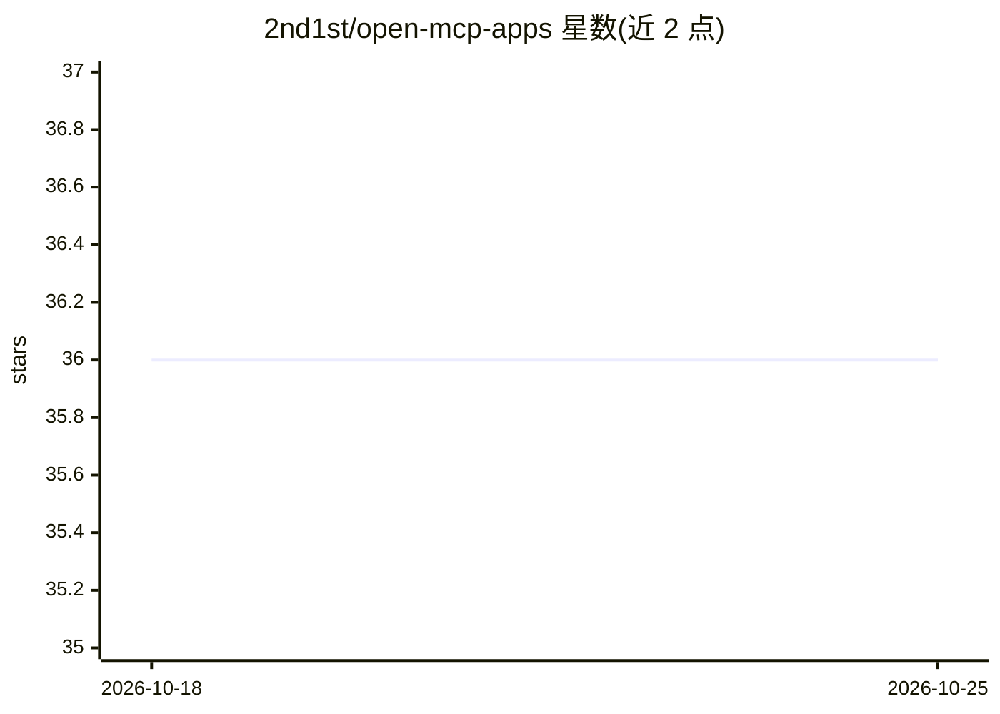

# 2nd1st/open-mcp-apps

⭐ 36 · JavaScript · MIT · 推送 2026-10-16 · [GitHub](https://github.com/2nd1st/open-mcp-apps) · [官网](https://openmcp.app) · 个人维护 · 中文 README

**为 MCP 主机提供 AI 可构建的持久化小程序引擎与应用商店**

基于 MCP Apps 扩展（ui://）的开源引擎，以本地 stdio MCP 服务器形式运行，供 Claude Desktop、Claude Code、Codex 等 MCP 主机使用。提供三项能力：AI 可写入的应用注册表（单文件 HTML 应用，window.oma API）、基于 SQLite 与追加式 change_event 账本的持久化版本化数据、以及包装官方 MCP App bridge 的 shell 运行时。内置 34 个工具、22 应用的 App Store 与托管版 openmcp.app。需 Node 22+，本机引擎仅绑定 127.0.0.1，浏览器主机（claude.ai、ChatGPT web）需远程部署。

## 筛选速览

| 维度 | 判定 | 备注 |
|---|---|---|
| AI 角色 | `ai-ecosystem` | LLM/agent 周边工具 |
| 许可风险 | `permissive` | MIT |
| 部署形态 | `library` | 以包/库形式分发 |
| 模型依赖 | — | README 未给出锁定关系 |
| 硬件要求 | — | 无带数字的原话,不猜 |
| 安装摩擦 | `low` | 无编译、无系统依赖或容器化 |
| 成熟度 | — | 结构信号不足 |

## 能力要点

- AI 按作者指南编写单文件 HTML 应用并可按名复用
- SQLite 集合存储与幂等领域命令、乐观并发（command_id/expected_version）
- 内置 App Store 与 3 个系统应用，引擎提供 34 个工具
- 数据存于固定的按用户存储，npx 与克隆安装共享同一数据

## 适用场景

- 让 AI 在对话中为自己生成看板、习惯追踪等持久化小工具
- 在不同 MCP 主机（Claude Desktop/Code、Codex）间共享同一批应用与数据
- 从 App Store 一键安装现成应用（学习卡片、家庭周计划等）

## 场景标签

 · 领域:AI 基础设施/MCP 工具

## 证据(README 行号)

> L13: **open-mcp-apps** is an open engine built on MCP Apps
> L26: 3. **A shell runtime so AI-written apps actually work.** Serving `ui://`, the engine wraps
> L51: open-mcp-apps runs as a local MCP server. First get it **connected** to your host (below); then

## 星数曲线

2026-10-18 36 → 2026-10-25 36（+0）

---
*卡片 v1 · prompt 1.4 · 生成 2026-10-25 · 置信度 high · 依据 README sha `075afe5622c2` · [字段定义](../../DATASET.md)*
