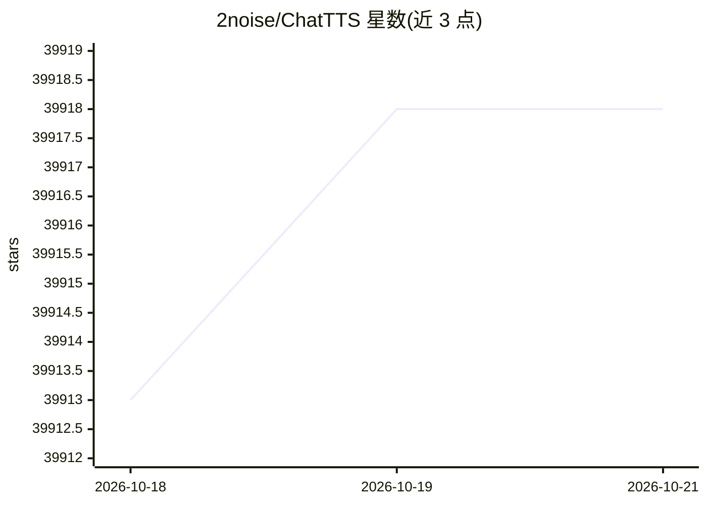

# 2noise/ChatTTS

⭐ 39,918 · Python · AGPL-3.0 · 推送 2026-04-10 · [GitHub](https://github.com/2noise/ChatTTS) · [官网](https://2noise.com) · 组织维护 · 中文 README

**面向对话场景的文本转语音生成模型，支持中英文**

ChatTTS 是面向 LLM 助手等对话场景的文本转语音模型，支持中英文输入。模型用 100,000+ 小时中英文音频训练，开源版本为无 SFT 的 40,000 小时预训练版，发布于 HuggingFace。支持多说话人、细粒度韵律控制（笑声、停顿、插入语），可控制 token 级标签 [laugh]、[uv_break]、[lbreak]。代码采用 AGPLv3+ 许可，模型采用 CC BY-NC 4.0 许可，仅限学术用途，禁止商用。训练中添加高频噪声并压缩音质以限制滥用。

## 筛选速览

| 维度 | 判定 | 备注 |
|---|---|---|
| AI 角色 | `ai-native` | 本体是模型或模型工具 |
| 许可风险 | `dual` | AGPL-3.0 |
| 部署形态 | `library` | 以包/库形式分发 |
| 模型依赖 | local-ok | 支持本地模型 |
| 硬件要求 | — | 无带数字的原话,不猜 |
| 安装摩擦 | `low` | 无编译、无系统依赖或容器化 |
| 成熟度 | — | 结构信号不足 |

## 动量与使用信号

- 维护:`declining` — 距上次 push 190.6 天,年发版 1,57 位贡献者
- 涨星:近 1 天 **+6**(自 20261016 起算)
- 安装:pypi 包 `ChatTTS` 月下载无数据
- 平台:LINUX · 协议:—

## 能力要点

- 面向对话任务优化的 TTS，支持多说话人交互
- 细粒度韵律控制：笑声、停顿、插入语
- 40,000 小时中英文预训练模型
- 提供 WebUI 与命令行两种推理入口

## 适用场景

- 为 LLM 助手生成对话语音
- 学术研究中的语音合成实验
- 生成带笑声与停顿控制的中英文语音

## 场景标签

`语音合成` · 领域:内容生成

## 证据(README 行号)

> L23: ChatTTS is a text-to-speech model designed specifically for dialogue scenarios such as LLM assistant.
> L41: - The main model is trained with Chinese and English audio data of 100,000+ hours.
> L94: #### Optional: Install vLLM (Linux only)

## 星数曲线

2026-10-18 39,913 → 2026-10-21 39,918（+5）

---
*卡片 v1 · prompt 1.4 · 生成 2026-10-18 · 置信度 high · 依据 README sha `69a1405e7424` · [字段定义](../../DATASET.md)*
