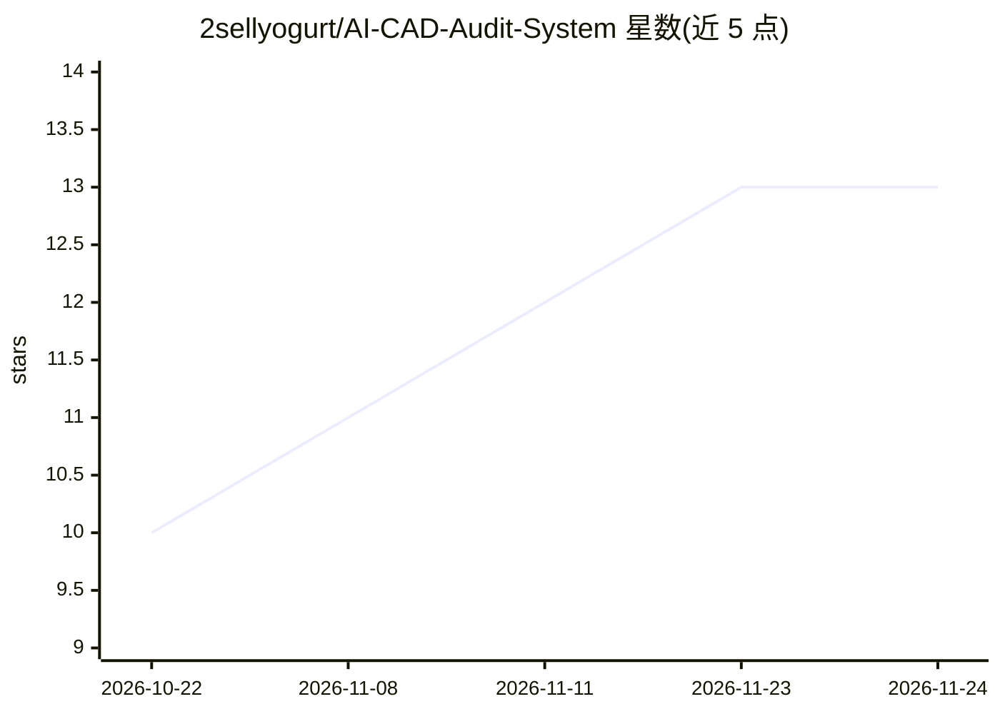

# 2sellyogurt/AI-CAD-Audit-System

⭐ 13 · Python · MIT · 推送 2026-06-25 · [GitHub](https://github.com/2sellyogurt/AI-CAD-Audit-System) · 个人维护 · 中文 README

**面向建筑审查的施工图 AI 合规审图平台（GB 规范）**

面向建筑设计审查场景的平台：解析 DXF/DWG 图纸，切分图框与轴线、识别比例后，按 GB 规范（GB50016、GB50011、GB50974 等）内置的 100+ 检查点执行合规检查。采用规则检查与大视觉语言模型审查的双路线架构，覆盖建筑、结构、暖通、给排水、电气、消防等 12 个专业，跨专业冲突核验后生成按角色分类的审查报告，并提供 Web 管理界面与离线演示模式。README 声明工具仅辅助人工审查，结论需专业工程师核验。

## 筛选速览

| 维度 | 判定 | 备注 |
|---|---|---|
| AI 角色 | `ai-native` | 本体是模型或模型工具 |
| 许可风险 | `permissive` | MIT |
| 部署形态 | `library` | 以包/库形式分发 |
| 模型依赖 | — | README 未给出锁定关系 |
| 硬件要求 | — | 无带数字的原话,不猜 |
| 安装摩擦 | `low` | 无编译、无系统依赖或容器化 |
| 成熟度 | — | 结构信号不足 |

## 能力要点

- 12 个专业 Agent 覆盖建筑/结构/暖通/电气/消防等审查
- 100+ 检查点映射到 GB 规范条目
- 规则检查 + 视觉语言模型审查的双路线架构
- DXF/DWG 解析：图框切分、轴线切分、比例识别

## 适用场景

- 施工图提交前按国标检查各专业合规问题
- 检测结构与机电等跨专业图纸冲突
- 生成总审/专业/交叉核验分类的审查报告
- 无 LLM API 环境下用离线模式演示审图流程

## 场景标签

`多模态` · 领域:感知与多模态

## 证据(README 行号)

> L24: AI CAD Audit System is an intelligent construction drawing review platform that leverages LLM (Large Language Model
> L33: - **LLM-Powered Analysis** — Dual-route architecture: rule-based checking + vision-language model review

## 星数曲线

2026-10-22 10 → 2026-11-24 13（+3）

---
*卡片 v1 · prompt 1.4 · 生成 2026-11-18 · 置信度 high · 依据 README sha `74ee98dd1ef5` · [字段定义](../../DATASET.md)*
