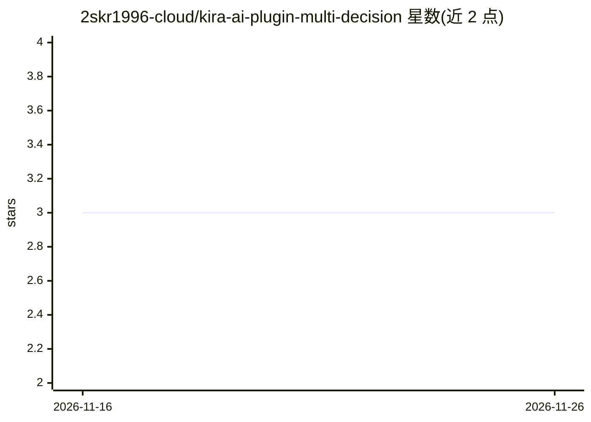

# 2skr1996-cloud/kira-ai-plugin-multi-decision

⭐ 3 · Python · MIT · 推送 2026-11-25 · [GitHub](https://github.com/2skr1996-cloud/kira-ai-plugin-multi-decision) · 个人维护 · 中文 README

**KiraAI 群聊插件：接管回复判定与上下文窗口管理**

面向 KiraAI 框架的聊天插件，替代内置掷骰子判定：支持计数/概率/时段/决策模式/JEV 决策等多种触发方式，自管上下文窗口（裁切、历史图片、转发与引用取回工具），提供网页设置页与记录页——判定、请求、裁切均留快照可复盘，支持按群覆盖配置、配额上限与用量花费统计。当前为 Beta 测试版，私聊、决策模式、JEV 决策尚未充分测试。需 KiraAI 3.0.0 以上并先配好聊天模型。

## 筛选速览

| 维度 | 判定 | 备注 |
|---|---|---|
| AI 角色 | `ai-enhanced` | 去掉 AI 部分产品仍成立 |
| 许可风险 | `permissive` | MIT |
| 部署形态 | `None` |  |
| 模型依赖 | — | README 未给出锁定关系 |
| 硬件要求 | — | 无带数字的原话,不猜 |
| 安装摩擦 | `low` | 无编译、无系统依赖或容器化 |
| 成熟度 | `idea` | |

## 能力要点

- 六种判定方式：计数、概率、时段曲线、动态调整、决策模式、JEV 决策
- 独立上下文窗口：裁切、128 张历史图片、view_forward/view_quote 取回工具
- 决策记录与窗口快照可逐条复盘，含用量与 API 花费统计
- 单群独立覆盖配置与每小时/每天配额上限

## 适用场景

- 让 QQ 群机器人不再随机沉默或抢答，按时段和概率控制开口频率
- 排查机器人为什么回/没回：翻决策记录和窗口快照
- 给不同群设置不同的聊天触发规则和配额
- 用便宜模型先判是否回复，控制 API 花费

## 场景标签

`聊天机器人` · 领域:对话与助手

## 证据(README 行号)

> L6: 一个给 KiraAI 用的聊天插件：决定机器人在群里什么时候开口，以及每次开口带多少前面的聊天记录。
> L8: KiraAI 自带的判定是随机掷骰子，要么半天不回，要么逮着一句就回。这个插件把「回不回、等多久回、带多少上下文」全搬到网页上，一条条能调、能看、能复盘。
> L64: |决策模式|另起一个模型读这一轮的消息判「回不回」，判回才跑完整一轮回复|

## 星数曲线

2026-11-16 3 → 2026-11-26 3（+0）

---
*卡片 v1 · prompt 1.4 · 生成 2026-11-22 · 置信度 high · 依据 README sha `221f335d3964` · [字段定义](../../DATASET.md)*
