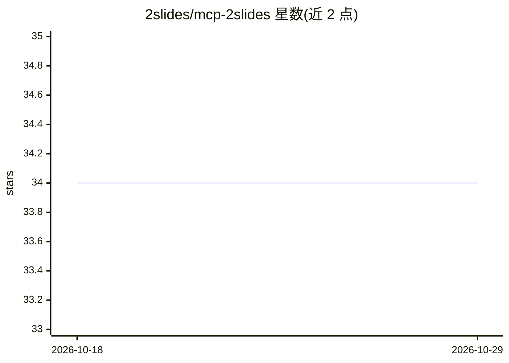

# 2slides/mcp-2slides

⭐ 34 · TypeScript · MIT · 推送 2026-09-01 · [GitHub](https://github.com/2slides/mcp-2slides) · [官网](https://2slides.com) · 组织维护

**把 2slides 幻灯片生成服务接入 MCP 客户端的服务器**

由 2slides.com 提供的 MCP 服务器，将该托管服务的 7 个工具暴露给 MCP 客户端（Claude Code、Claude Desktop 等）：基于主题生成 PowerPoint（Fast PPT）、参考图风格生成自定义幻灯片与 PDF 幻灯片（Nano Banana）、任务轮询、30 种语音的单/双人 AI 配音及页面与音频 ZIP 导出。提供托管 Streamable HTTP 端点与 stdio npm 包两种接入方式，需在 2slides.com/api 获取 API key，各工具按 credit 计费（如生成每页 1 credit、配音每页 210 credits）。

## 筛选速览

| 维度 | 判定 | 备注 |
|---|---|---|
| AI 角色 | `ai-ecosystem` | LLM/agent 周边工具 |
| 许可风险 | `permissive` | MIT |
| 部署形态 | `library` | 以包/库形式分发 |
| 模型依赖 | — | README 未给出锁定关系 |
| 硬件要求 | — | 无带数字的原话,不猜 |
| 安装摩擦 | `low` | 无编译、无系统依赖或容器化 |
| 成熟度 | — | 结构信号不足 |

## 能力要点

- 7 个 MCP 工具：主题搜索、PPT 生成、参考图/PDF 幻灯片生成、任务轮询
- 30 种语音的单/双人 AI 配音与 ZIP 导出（页面图 + 音频 + 文稿）
- Streamable HTTP 托管端点与 stdio npm 包双通道，共享账户与 credits
- 生成支持 19 种输出语言，含简繁体中文；分辨率 1K/2K/4K

## 适用场景

- 在 Claude Code/Desktop 中用对话生成带主题的 PPT
- 按参考图风格生成自定义设计的演示幻灯片
- 为幻灯片批量生成 AI 语音旁白并打包下载

## 场景标签

`AI 写作` `语音合成` · 领域:内容生成

## 证据(README 行号)

> L5: Expose 2slides.com tools to MCP clients: generate PowerPoint decks
> L14: 2slides runs a hosted **Streamable HTTP** MCP endpoint, and also ships this **stdio**

## 星数曲线

2026-10-18 34 → 2026-10-29 34（+0）

---
*卡片 v1 · prompt 1.4 · 生成 2026-10-25 · 置信度 high · 依据 README sha `da7454792381` · [字段定义](../../DATASET.md)*
