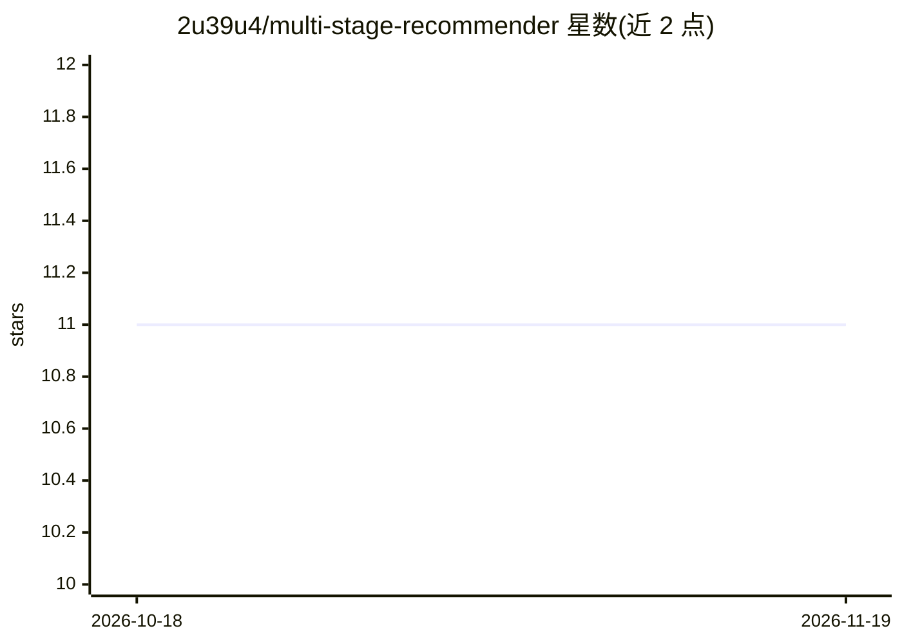

# 2u39u4/multi-stage-recommender

⭐ 11 · Python · MIT · 推送 2026-06-27 · [GitHub](https://github.com/2u39u4/multi-stage-recommender) · [官网](https://github.com/2u39u4/multi-stage-recommender) · 个人维护

**基于 MovieLens 的多阶段推荐系统全流程项目**

NeoRec 是一个端到端的多阶段推荐系统项目，在 MovieLens-1M 上实现召回→粗排/精排→重排→服务的完整漏斗：5 路召回（iALS、Two-Tower、SASRec、热门、冷启动）经 RRF 融合，排序层提供 LR/GBDT/DeepFM/DIN，重排采用 MMR 与流行度去偏，通过 FastAPI 与 Streamlit 面板提供服务，并用 MLflow 跟踪实验、Hydra 管理配置、Docker Compose 部署。定位为作品集项目，训练采用 OOF 协议避免前视偏差。

## 筛选速览

| 维度 | 判定 | 备注 |
|---|---|---|
| AI 角色 | `ai-native` | 本体是模型或模型工具 |
| 许可风险 | `permissive` | MIT |
| 部署形态 | `self-host` | docker 或自建部署 |
| 模型依赖 | — | README 未给出锁定关系 |
| 硬件要求 | — | 无带数字的原话,不猜 |
| 安装摩擦 | `low` | 无编译、无系统依赖或容器化 |
| 成熟度 | — | 结构信号不足 |

## 能力要点

- 5 路召回通道经 RRF 融合，Recall@10 从 0.0590 提升到 0.0827
- 排序层实现 LR/GBDT/DeepFM/DIN 四种模型并给出对比实验
- MMR 多样性重排与 IPS 去偏、业务规则过滤
- FastAPI + Streamlit 服务，含 Prometheus 钩子与 Docker Compose

## 适用场景

- 学习工业级多阶段推荐漏斗的完整实现
- 复现 MovieLens-1M 上的召回融合与排序对比实验
- 部署带监控的推荐服务 API 与可视化面板

## 场景标签

`推荐系统` `MLOps` · 领域:学习与行业

## 证据(README 行号)

> L3: > Portfolio-ready recommender system on MovieLens: multi-channel recall →
> L19: NeoRec is an end-to-end recommender portfolio project that mirrors an industrial
> L38: |Serving|`/recommend`, `/metrics`, dashboard|local p50 **23.5 ms**; Docker p50 **~1.0 s**|

## 星数曲线

2026-10-18 11 → 2026-11-19 11（+0）

---
*卡片 v1 · prompt 1.4 · 生成 2026-11-19 · 置信度 high · 依据 README sha `67a70817e944` · [字段定义](../../DATASET.md)*
