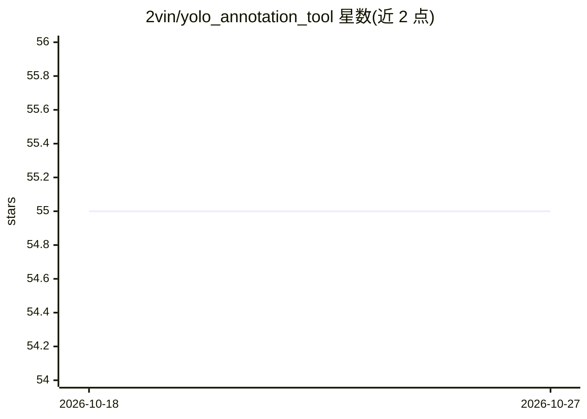

# 2vin/yolo_annotation_tool

⭐ 55 · C++ · GPL-3.0 · 推送 2026-04-12 · [GitHub](https://github.com/2vin/yolo_annotation_tool) · 个人维护

**供研究者快速标注 YOLO 数据集的 OpenCV C++ 工具**

面向研究人员和深度学习开发者的开源标注工具，基于 OpenCV C++ 编写，用于快速为 YOLO 目标检测框架创建标注数据集。通过克隆仓库、运行 compile.sh 编译后使用：标注窗口支持按键翻帧、跳帧、重置与保存标注，Trackbar 切换类别并以计数文件跟踪进度。面向视频帧逐张标注输出 YOLO 格式数据。README 同时指出了其 Python 版替代实现 PyYAT。

## 筛选速览

| 维度 | 判定 | 备注 |
|---|---|---|
| AI 角色 | `ai-ecosystem` | LLM/agent 周边工具 |
| 许可风险 | `viral` | GPL-3.0 |
| 部署形态 | `None` |  |
| 模型依赖 | — | README 未给出锁定关系 |
| 硬件要求 | — | 无带数字的原话,不猜 |
| 安装摩擦 | `low` | 无编译、无系统依赖或容器化 |
| 成熟度 | — | 结构信号不足 |

## 能力要点

- 基于 OpenCV C++ 的 YOLO 数据集标注工具
- 键盘快捷键翻帧/跳帧/重置/保存标注
- Trackbar 切换标注类别并显示当前类标签
- 通过 /data/index.txt 计数文件跟踪标注进度

## 适用场景

- 为 YOLO 目标检测训练准备标注数据集
- 逐帧标注视频并输出 YOLO 格式标注文件

## 场景标签

 · 领域:计算机视觉/数据标注

## 证据(README 行号)

> L9: This is an open-source tool for researchers to annotate dataset for YOLO quickly in opencv. If you are familiar with
> L13: 2. Compile the program using the instructions in the file 'compile.sh'

## 星数曲线

2026-10-18 55 → 2026-10-27 55（+0）

---
*卡片 v1 · prompt 1.4 · 生成 2026-10-24 · 置信度 high · 依据 README sha `ebbb047f1498` · [字段定义](../../DATASET.md)*
