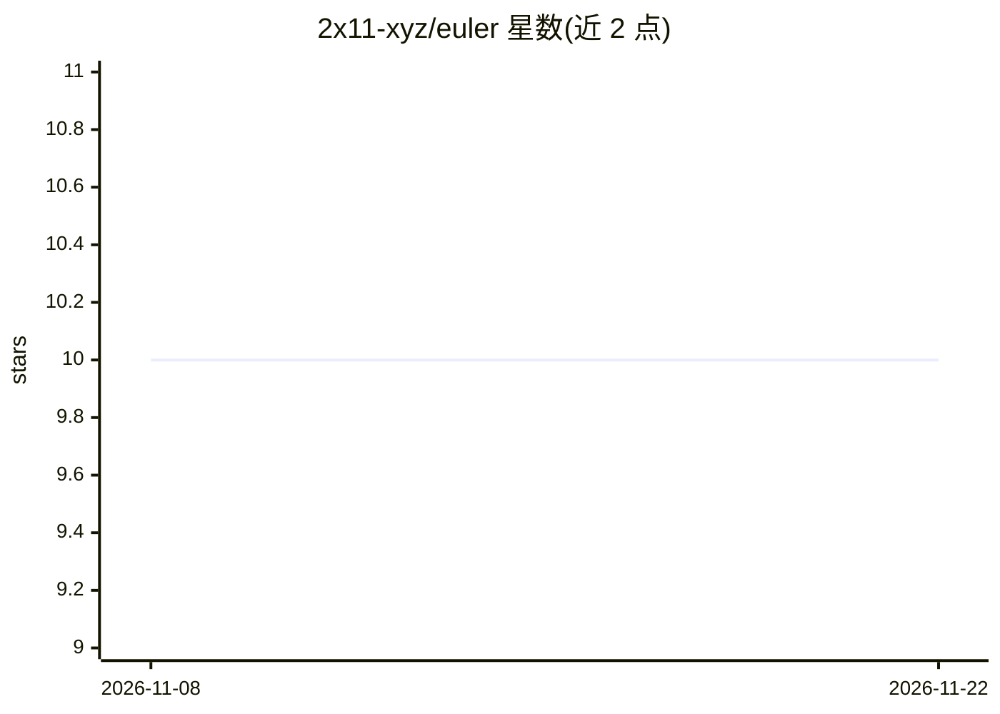

# 2x11-xyz/euler

⭐ 10 · Rust · MIT · 推送 2026-11-06 · [GitHub](https://github.com/2x11-xyz/euler) · 组织维护

**终端里的研究/编码 agent 与可运行时扩展的平台**

Euler 是一个在终端运行的研究与编码 agent，同时是可扩展平台：核心保持精简，扩展通过 euler-sdk 添加命令、上下文槽、artifact、checkpoint 等能力。每次会话记录为 append-only 事件日志，涵盖模型调用、工具调用与权限决策，可事后重建；官方扩展集含 session-export、autoresearch、因果 DAG 等。支持 OpenAI、Anthropic、OpenRouter 与自定义 OpenAI 兼容端点，本地优先，shell 与 Git 工具默认在沙箱中运行。提供 Linux/macOS 预编译二进制与源码构建，v0.1.0，接口可能变动。

## 筛选速览

| 维度 | 判定 | 备注 |
|---|---|---|
| AI 角色 | `ai-native` | 本体是模型或模型工具 |
| 许可风险 | `permissive` | MIT |
| 部署形态 | `desktop` | 安装包/桌面程序 |
| 模型依赖 | local-ok | 支持本地模型 |
| 硬件要求 | — | 无带数字的原话,不猜 |
| 安装摩擦 | `medium` | 含编译或系统依赖之一 |
| 成熟度 | `idea` | |

## 能力要点

- append-only 事件日志记录模型调用、工具调用与权限决策
- 通过 euler-sdk 运行时扩展：命令、上下文槽、artifact、checkpoint
- 因果 DAG：会话渲染为可查询的分支尝试树
- shell/Git 工具默认在 Bubblewrap/Seatbelt 沙箱中执行

## 适用场景

- 在终端运行研究与编码 agent 并保留完整过程溯源
- 把失败的尝试作为可查询数据，让后续会话复用
- 通过扩展机制构建自定义 agent 工作流
- 接入 OpenAI 兼容端点（含 ollama/vLLM 本地模型）

## 场景标签

`编码 Agent` · 领域:编码与开发

## 证据(README 行号)

> L5: **Euler is a research agent (coding agent included) and an open-ended
> L31: - **Multi-model, multi-agent, trust-aware.** Supports OpenAI, Anthropic, and
> L123: Euler is designed as a platform, not a fixed agent, and it ships core-only:

## 星数曲线

2026-11-08 10 → 2026-11-22 10（+0）

---
*卡片 v1 · prompt 1.4 · 生成 2026-11-20 · 置信度 high · 依据 README sha `f045a1e69590` · [字段定义](../../DATASET.md)*
