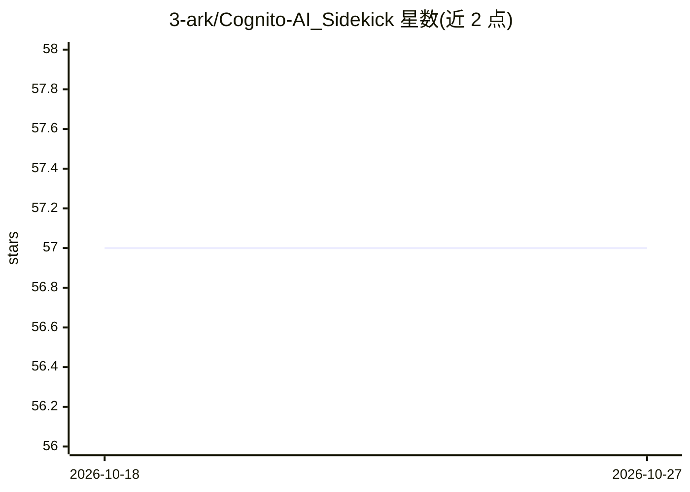

# 3-ark/Cognito-AI_Sidekick

⭐ 57 · TypeScript · MIT · 推送 2026-10-23 · [GitHub](https://github.com/3-ark/Cognito-AI_Sidekick) · [官网](https://chromewebstore.google.com/detail/cognito/pphjdjdoclkedgiaahmiahladgcpohca?authuser=0&hl=en) · 个人维护

**带 RAG 与笔记功能的 Chrome 浏览器 AI 侧边栏助手**

Chrome 扩展形态的侧边栏 AI 助手：支持网页/维基搜索摘要、右键一键收藏网页为结构化笔记（Markdown+YAML，可导出至 Obsidian）、长短期记忆、多模型与多 Persona 选择、9 个原生工具及 MCP 工具扩展，响应为纯 JSON 结构。检索采用 BM25+语义嵌入混合 RAG（语义部分仅在私有/开发构建提供），可调整融合权重，手动重建索引。技术栈为 React/TypeScript/Redux/Tailwind/Webpack；可通过 Chrome Webstore 安装或源码构建后以开发者模式加载，支持接入本地 Ollama。

## 筛选速览

| 维度 | 判定 | 备注 |
|---|---|---|
| AI 角色 | `ai-native` | 本体是模型或模型工具 |
| 许可风险 | `permissive` | MIT |
| 部署形态 | `library` | 以包/库形式分发 |
| 模型依赖 | local-ok | 支持本地模型 |
| 硬件要求 | — | 无带数字的原话,不猜 |
| 安装摩擦 | `low` | 无编译、无系统依赖或容器化 |
| 成熟度 | — | 结构信号不足 |

## 能力要点

- BM25+语义嵌入混合 RAG，融合权重 α 可调
- 右键收藏网页为结构化笔记并支持 Markdown+YAML 导出
- 9 个原生工具加可扩展 MCP 工具，响应为纯 JSON
- 支持接入本地 Ollama（如 localhost:11434 的 Llama3）

## 适用场景

- 浏览网页时用自然语言总结页面或解释选中内容
- 把网页片段保存为结构化笔记并接入 Obsidian 知识库
- 在浏览器内连接本地 LLM 进行对话问答

## 场景标签

`AI 助手` `知识库管理` · 领域:对话与助手

## 证据(README 行号)

> L6: Cognito is your intelligent browser companion — combining RAG, TTS/STT, note-taking, and customizable personas into 
> L153: * **Connect to Local LLM:** If you have Ollama running with a model like Llama3, go to Cognito's settings, select 

## 星数曲线

2026-10-18 57 → 2026-10-27 57（+0）

---
*卡片 v1 · prompt 1.4 · 生成 2026-10-24 · 置信度 high · 依据 README sha `a9827c635064` · [字段定义](../../DATASET.md)*
