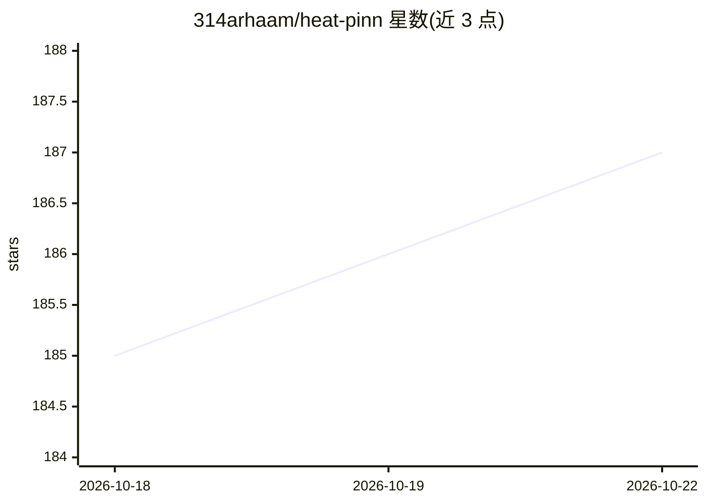

# 314arhaam/heat-pinn

⭐ 187 · Python · MIT · 推送 2026-05-30 · [GitHub](https://github.com/314arhaam/heat-pinn) · 个人维护

**求解 2D 稳态热传导方程的物理信息神经网络（PINN）**

基于 TensorFlow 2.0 实现的物理信息神经网络项目，训练网络求解带 Dirichlet 边界条件的 2D 稳态热方程，并将结果与有限差分法（FDM）的 Python 实现对比。提供 Build/Train/Inference 的 CLI 流程，验证覆盖方形、圆环、螺杆、连杆、齿轮等多种几何，并在 100×100 网格上给出 PINN（66.35s）与 FDM（77.60s）的耗时数据。方法论出自 Physics Informed Deep Learning (Part I) 论文，开发借助 Google Colaboratory GPU。

## 筛选速览

| 维度 | 判定 | 备注 |
|---|---|---|
| AI 角色 | `ai-native` | 本体是模型或模型工具 |
| 许可风险 | `permissive` | MIT |
| 部署形态 | `None` |  |
| 模型依赖 | — | README 未给出锁定关系 |
| 硬件要求 | — | 无带数字的原话,不猜 |
| 安装摩擦 | `low` | 无编译、无系统依赖或容器化 |
| 成熟度 | — | 结构信号不足 |

## 能力要点

- 训练 PINN 求解 2D 稳态热方程并给出控制方程与边界条件定义
- 与有限差分法（FDM）结果及计算耗时对比
- CLI 覆盖 Build/Train/Inference 流程
- 验证多种几何：方形、圆环、螺杆、连杆、齿轮

## 适用场景

- 用神经网络求解传热/偏微分方程并对比传统数值方法
- 学习 PINN 在热传导问题上的实现方式
- 复现不同几何下的稳态温度场计算

## 场景标签

 · 领域:科学计算/物理信息机器学习

## 证据(README 行号)

> L7:  A Physics-Informed Neural Network, to solve 2D steady-state heat equation based on the methodology, introduced in: 
> L14: In this project, a PINN is trained to solve a 2D heat equation and the final results is compared to a solution base

## 星数曲线

2026-10-18 185 → 2026-10-22 187（+2）

---
*卡片 v1 · prompt 1.4 · 生成 2026-10-22 · 置信度 high · 依据 README sha `cd2f56aa46ab` · [字段定义](../../DATASET.md)*
