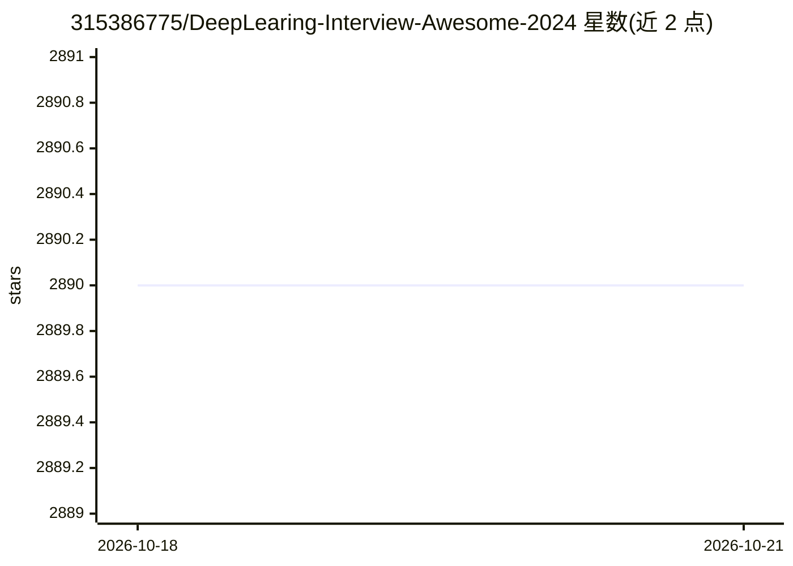

# 315386775/DeepLearing-Interview-Awesome-2024

⭐ 2,890 · 推送 2026-03-05 · [GitHub](https://github.com/315386775/DeepLearing-Interview-Awesome-2024) · 个人维护 · 中文 README

**深度学习/大模型面试题与解析合集（6大专题）**

面向算法岗求职者与科研人员的面试知识仓库：按大模型(LLMs)、计算机视觉与感知算法、深度学习基础与框架、行业垂域、手撕代码、开源资源推荐六大专题组织，收录高频面试题与解析，题目来源包括各大厂面试题与论文创新点。内容覆盖模型微调、Transformer结构、目标检测分割、PyTorch操作与训练框架等。以 Markdown 文档形式持续更新，无代码安装需求，部分题目解析尚不完整。

## 筛选速览

| 维度 | 判定 | 备注 |
|---|---|---|
| AI 角色 | `ai-knowledge` | 知识聚合/清单类 |
| 许可风险 | `none` | — |
| 部署形态 | `None` |  |
| 模型依赖 | — | README 未给出锁定关系 |
| 硬件要求 | — | 无带数字的原话,不猜 |
| 安装摩擦 | `low` | 无编译、无系统依赖或容器化 |
| 成熟度 | — | 结构信号不足 |

## 能力要点

- 6大专题模块覆盖 LLMs、CV、深度学习基础、行业垂域等方向
- 题目来源于大厂高频面试题与最新论文创新点思考
- 持续更新，覆盖微调、推理优化、检测分割、分布式训练等主题

## 适用场景

- 算法岗面试前按专题系统复习深度学习与大模型知识点
- 科研或工作中查找特定模型结构与优化问题的问题解析
- 了解学术界与工业界面试考察方向的分布

## 场景标签

`精选清单` · 领域:学习与行业

## 证据(README 行号)

> L3: 本项目涵盖了**大模型(LLMs)专题**、**计算机视觉与感知算法专题**、**深度学习基础与框架专题**、**自动驾驶、智慧医疗等行业垂域专题**、**手撕项目代码专题**、**优异开源资源推荐专题**共计6大专题模块。我们将持
> L11: - 本文录入题目的原则：**高新深**，其中高是指-各大厂公司近年高频算法面试题，新是指-题目要新紧跟学术和工业界的发展，比如录入了大量大模型领域的面试题，深是指-题目要有一定的内容与深度，可以引人思考，比如面向业务场景改进的面试

## 星数曲线

2026-10-18 2,890 → 2026-10-21 2,890（+0）

---
*卡片 v1 · prompt 1.4 · 生成 2026-10-21 · 置信度 high · 依据 README sha `eb2e76dfabbc` · [字段定义](../../DATASET.md)*
