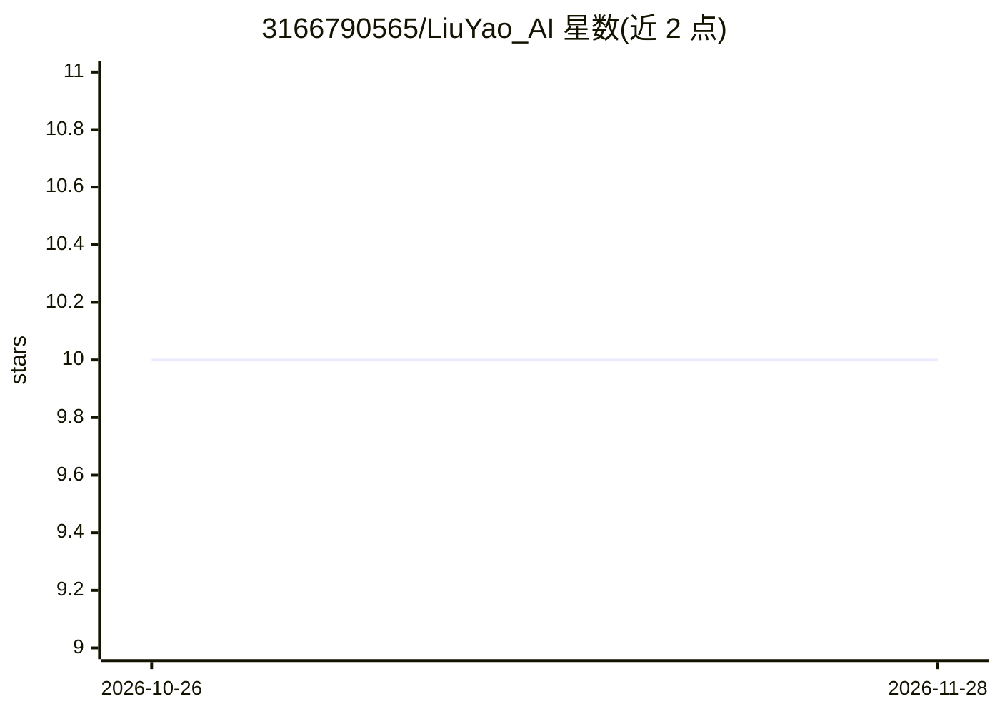

# 3166790565/LiuYao_AI

⭐ 10 · Python · 推送 2026-05-14 · [GitHub](https://github.com/3166790565/LiuYao_AI) · 个人维护

**面向易学爱好者的 AI 六爻等传统易学解读桌面应用**

Python 编写的桌面应用程序：AI 分析用户提问并提取需求，结合六爻、奇门遁甲、八字、紫微斗数等多种易学体系生成解读结果。通过 RAG 检索 docx/ 目录中的易学文献（TF-IDF/BM25/FAISS 向量检索、jieba 分词），检索结果融入 AI 分析过程；支持多轮对话、PDF/Word 导出、文档变化自动重建索引。需 Python 3.8+、联网调用 AI 接口，Tkinter 界面，可用 PyInstaller 打包。解读结果仅供参考。

## 筛选速览

| 维度 | 判定 | 备注 |
|---|---|---|
| AI 角色 | `ai-native` | 本体是模型或模型工具 |
| 许可风险 | `none` | — |
| 部署形态 | `library` | 以包/库形式分发 |
| 模型依赖 | locked-api |  |
| 硬件要求 | — | 无带数字的原话,不猜 |
| 安装摩擦 | `low` | 无编译、无系统依赖或容器化 |
| 成熟度 | — | 结构信号不足 |

## 能力要点

- RAG 检索增强：TF-IDF/BM25/FAISS 检索本地易学文献并融入分析
- 支持 10 种易学体系（六爻、奇门遁甲、八字、紫微斗数等）
- 接入 GPT 系列、Claude 系列及用户自定义模型
- 支持多轮对话、PDF/Word 结果导出、PyInstaller 打包

## 适用场景

- 输入问题后获取六爻卦象及 AI 解读结果
- 基于自有易学文献库构建检索增强分析
- 将解读结果导出为 PDF/Word 保存

## 场景标签

`RAG` · 领域:知识与检索

## 证据(README 行号)

> L15: AI易学分析系统是一个结合人工智能与传统易学预测术的现代化应用程序。系统通过AI分析用户的问题，提取关键需求方面，并结合各种易学体系（六爻、奇门遁甲、大六壬、金口诀、八字、河洛理数、玄空择日、紫微斗数、梅花易数、太乙神数等）进行专
> L24: - **🤖 AI驱动**: 集成多种大语言模型（GPT-4.1、GPT-4、GPT-4o等）
> L37: - 📚 **RAG检索增强**: 基于传统易学文献的智能检索，显著提升解卦准确性

## 星数曲线

2026-10-26 10 → 2026-11-28 10（+0）

---
*卡片 v1 · prompt 1.4 · 生成 2026-11-20 · 置信度 high · 依据 README sha `edbbc9813b75` · [字段定义](../../DATASET.md)*
