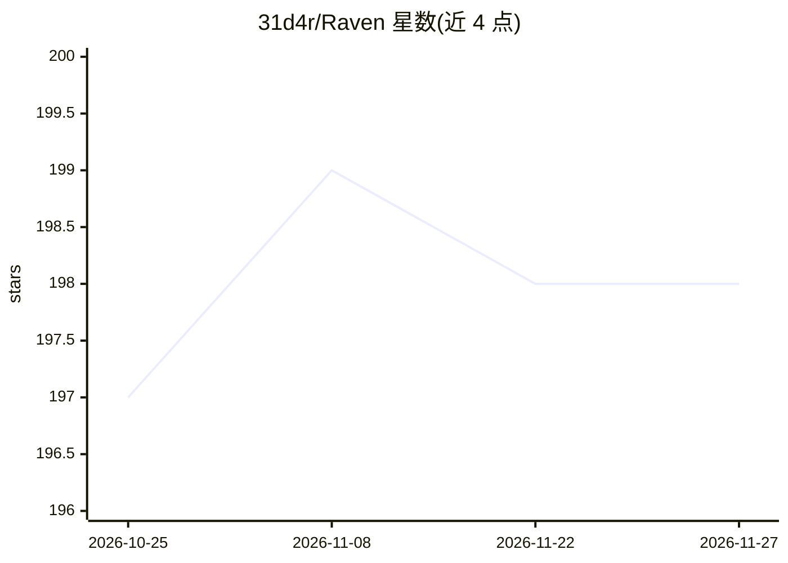

# 31d4r/Raven

⭐ 198 · Swift · MIT · 推送 2026-11-08 · [GitHub](https://github.com/31d4r/Raven) · 个人维护

**macOS/iOS 上的本地文档问答应用：上传文件提问，全程设备端运行**

面向 iPhone 和 Mac 用户的设备端文档助手：将 PDF、照片、音频或视频添加到对话中，针对文件提问并获得基于文件内容的回答与摘要。所有处理通过 Apple Foundation Models 在本地完成，不发送数据到服务器或云端，AI 功能无需联网。支持来源面板查看引用、跨会话搜索、Projects 文件组织。需 iOS 26 / macOS 26 Tahoe 且设备支持 Apple Foundation Models；可通过 App Store 安装或用 Xcode 26 从源码构建。

## 筛选速览

| 维度 | 判定 | 备注 |
|---|---|---|
| AI 角色 | `ai-native` | 本体是模型或模型工具 |
| 许可风险 | `permissive` | MIT |
| 部署形态 | `None` |  |
| 模型依赖 | — | README 未给出锁定关系 |
| 硬件要求 | — | 无带数字的原话,不猜 |
| 安装摩擦 | `low` | 无编译、无系统依赖或容器化 |
| 成熟度 | — | 结构信号不足 |

## 能力要点

- 基于 Apple Foundation Models 的全本地文档问答与摘要
- 支持 PDF、图片、音频、视频的文本提取
- 来源面板展示每条回答所依据的文件
- Projects 在设备端组织文件，数据不出设备

## 适用场景

- 在 iPhone/Mac 上离线阅读并提问长 PDF 文档
- 对照片、录音、视频内容做摘要与问答
- 处理涉密或隐私文件且不希望上传云端

## 场景标签

`文档问答` · 领域:知识与检索

## 证据(README 行号)

> L14: Raven is an on-device document assistant for iPhone and Mac. You add PDFs, photos, audio, or video to a chat, then 
> L16: All processing runs locally with Apple Foundation Models. Nothing is sent to a server or cloud service.

## 星数曲线

2026-10-25 197 → 2026-11-27 198（+1）

---
*卡片 v1 · prompt 1.4 · 生成 2026-11-25 · 置信度 high · 依据 README sha `9b5c7f5d480a` · [字段定义](../../DATASET.md)*
