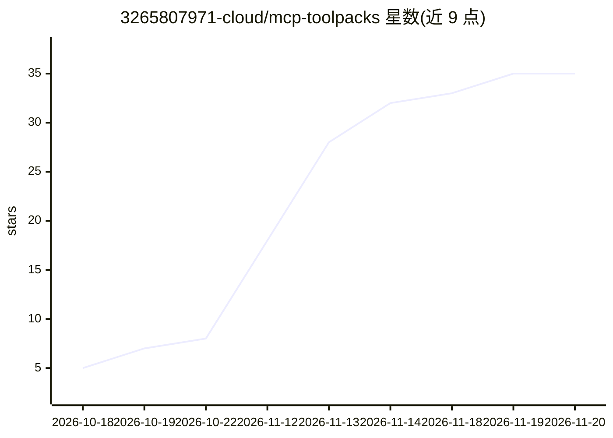

# 3265807971-cloud/mcp-toolpacks

⭐ 35 · TypeScript · MIT · 推送 2026-10-13 · [GitHub](https://github.com/3265807971-cloud/mcp-toolpacks) · 个人维护 · 中文 README

**按用途给 MCP 工具分组并整组开关的参考实现**

面向 MCP 客户端开发者的工具分组方案：以 pack 为单位，按服务器名+工具名引用一组工具并配一个开关，解决整台服务器全开/全关导致上下文 token 浪费与权限过大的问题。核心 resolve() 按开着的包的并集覆盖工具开关，名字对不上时拦截开启操作，状态不落库而是实时计算。附 22 条测试、validate() 健康检查、七条实现经验说明与 React 示例组件。无运行时依赖，约八十行核心逻辑，MIT 许可。

## 筛选速览

| 维度 | 判定 | 备注 |
|---|---|---|
| AI 角色 | `ai-ecosystem` | LLM/agent 周边工具 |
| 许可风险 | `permissive` | MIT |
| 部署形态 | `library` | 以包/库形式分发 |
| 模型依赖 | — | README 未给出锁定关系 |
| 硬件要求 | — | 无带数字的原话,不猜 |
| 安装摩擦 | `low` | 无编译、无系统依赖或容器化 |
| 成熟度 | — | 结构信号不足 |

## 能力要点

- pack 按服务器名+工具名引用工具，实现同服务器多包并存
- resolve() 按并集覆盖计算工具开关，返回完整新 AppState
- 名字对不上时拦截开启并返回 blocked 列表，不静默失效
- 无运行时依赖，含 22 条以 bug 命名的测试与 validate() 健康检查

## 适用场景

- 我的 MCP 客户端只想开某服务器的部分工具、控制上下文开销
- 为已上线的 MCP 工具管理功能补上防静默失效的测试与校验
- 参考七条实现经验，规避工具分组切换的典型事故

## 场景标签

 · 领域:LLM 基础设施/MCP 工具管理

## 证据(README 行号)

> L3: **按用途给 MCP 工具分组，而不是按服务器。一组一个开关。**
> L45: 一个 **pack**：一组按用途命名的工具引用，配一个开关。
> L208: ├── resolve.ts    ★ 核心：resolve() / isOn() / unavailable()

## 星数曲线

2026-10-18 5 → 2026-11-20 35（+30）

---
*卡片 v1 · prompt 1.4 · 生成 2026-11-18 · 置信度 high · 依据 README sha `8a8268e8a449` · [字段定义](../../DATASET.md)*
