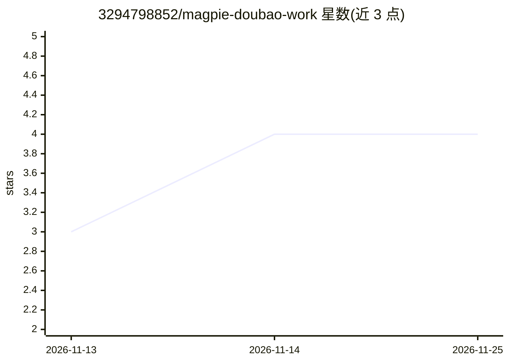

# 3294798852/magpie-doubao-work

⭐ 4 · JavaScript · NOASSERTION · 推送 2026-11-14 · [GitHub](https://github.com/3294798852/magpie-doubao-work) · 个人维护 · 中文 README

**为 Magpie 提供豆包工作供应商接入的插件**

magpie-doubao-work 是 Magpie 的供应商插件，提供 doubaowork 供应商：通过豆包网页浏览器登录或账号 JSON 导入接入，提供模型发现、OpenAI 风格文本对话（流式与非流式）、function 工具调用、reasoning_content 透传、额度查询与每日签到。插件从 doubao-work-gateway v0.5.0 拆分而来，无桌面环境的 Linux 可用独立网关导出的账号 JSON。源码验收需 Node.js 22 及以上。

## 筛选速览

| 维度 | 判定 | 备注 |
|---|---|---|
| AI 角色 | `ai-ecosystem` | LLM/agent 周边工具 |
| 许可风险 | `none` | NOASSERTION |
| 部署形态 | `None` |  |
| 模型依赖 | — | README 未给出锁定关系 |
| 硬件要求 | — | 无带数字的原话,不猜 |
| 安装摩擦 | `low` | 无编译、无系统依赖或容器化 |
| 成熟度 | — | 结构信号不足 |

## 能力要点

- 浏览器扫码/验证登录，免安装豆包桌面客户端
- OpenAI 风格 chat/completions 文本接口与流式输出
- 客户端 function 工具调用（auto/none/required、并行开关）
- 额度查询与由 Magpie 调度的每日签到

## 适用场景

- 在 Magpie 中接入豆包工作账号进行文本对话
- 无图形界面的 Linux 服务器通过 JSON 导入账号
- 自动完成豆包工作每日签到并查询额度

## 场景标签

`聊天机器人` · 领域:对话与助手

## 证据(README 行号)

> L5: `magpie-doubao-work` 为 Magpie 提供豆包工作供应商 `doubaowork`，支持 Windows、Linux 和 macOS。通过豆包网页登录或账号 JSON 导入接入，提供模型发现、文本对话、func
> L70: 支持 OpenAI 风格 `chat/completions` 文本接口、流式与非流式回复，以及 `reasoning_content` 透传。取消会中止上游请求，输出按消费者读取速度推进。

## 星数曲线

2026-11-13 3 → 2026-11-25 4（+1）

---
*卡片 v1 · prompt 1.4 · 生成 2026-11-21 · 置信度 high · 依据 README sha `a412672a5ba5` · [字段定义](../../DATASET.md)*
