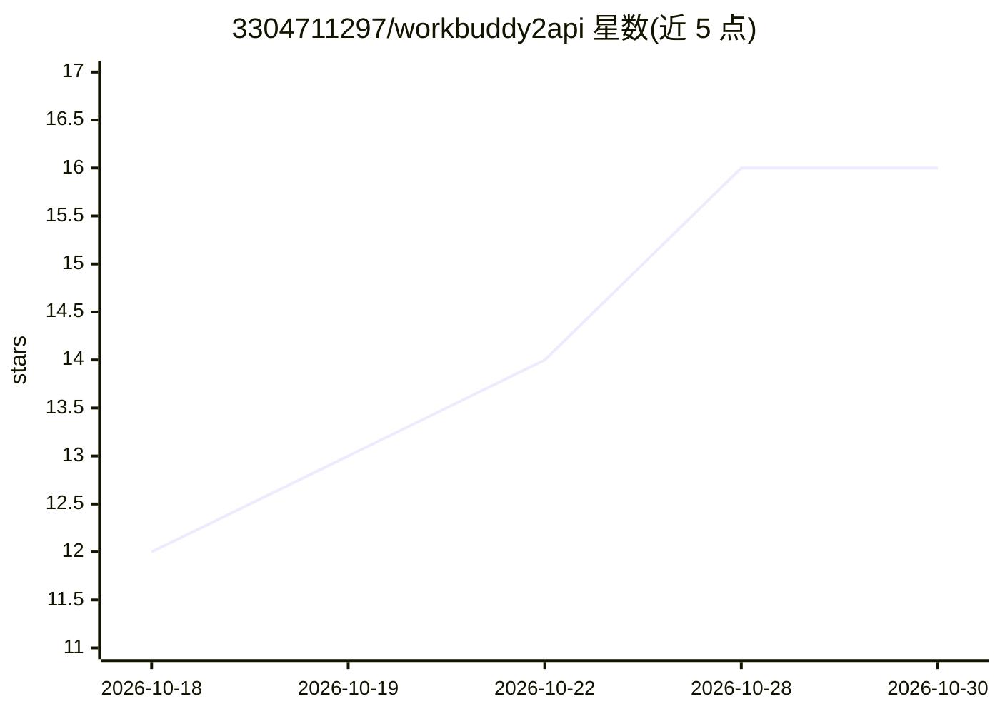

# 3304711297/workbuddy2api

⭐ 16 · Python · MIT · 推送 2026-10-20 · [GitHub](https://github.com/3304711297/workbuddy2api) · 个人维护 · 中文 README

**把腾讯 WorkBuddy 订阅转为本地三协议 API 网关的桌面端**

基于 Tauri v2 的桌面控制台与本地 API 网关：通过浏览器 OAuth 授权腾讯 WorkBuddy / CodeBuddy 订阅（无需官方客户端），将其能力转换为 OpenAI Chat、Anthropic Messages、OpenAI Responses 三种标准协议端点，本地监听 127.0.0.1:8787，供 Claude Code CLI、Codex CLI、Cline 等编码代理直连。含多账号调度（按到期日分层、429 Failover、轮询）、用量分析、API 调试台、日志脱敏与限流削峰机制。提供桌面编译产物运行与源码构建两种方式。

## 筛选速览

| 维度 | 判定 | 备注 |
|---|---|---|
| AI 角色 | `ai-ecosystem` | LLM/agent 周边工具 |
| 许可风险 | `permissive` | MIT |
| 部署形态 | `desktop` | 安装包/桌面程序 |
| 模型依赖 | — | README 未给出锁定关系 |
| 硬件要求 | — | 无带数字的原话,不猜 |
| 安装摩擦 | `low` | 无编译、无系统依赖或容器化 |
| 成熟度 | — | 结构信号不足 |

## 能力要点

- 原生三协议端点：/v1/chat/completions、/v1/messages、/v1/responses
- 多账号调度：到期日优先分层、429/6004 故障转移、轮询负载均衡
- 本地凭据存储与日志自动脱敏、Origin/Host 双校验防护
- 内置用量 SVG 图表与最近 200 条请求调试回放台

## 适用场景

- 用 Claude Code / Codex CLI 等编码代理接入自己的 WorkBuddy 订阅
- 多账号额度统一管理与临期优先消耗
- 本地调试各协议 API 请求并回放

## 场景标签

`模型网关` · 领域:Agent 开发

## 证据(README 行号)

> L3: ### 独立桌面控制台 · WorkBuddy 转 OpenAI / Anthropic / Responses 三协议 API 网关 · 多账号资产管理 · Coding Agent 接入引导
> L17:  A standalone Tauri v2 desktop console & local tri-protocol API gateway converting Tencent WorkBuddy / CodeBuddy su
> L114: 本地服务默认监听 `http://127.0.0.1:8787`，提供以下标准 API 与工具端点：

## 星数曲线

2026-10-18 12 → 2026-10-30 16（+4）

---
*卡片 v1 · prompt 1.4 · 生成 2026-10-30 · 置信度 mid · 依据 README sha `7b2a5af0fa45` · [字段定义](../../DATASET.md)*
