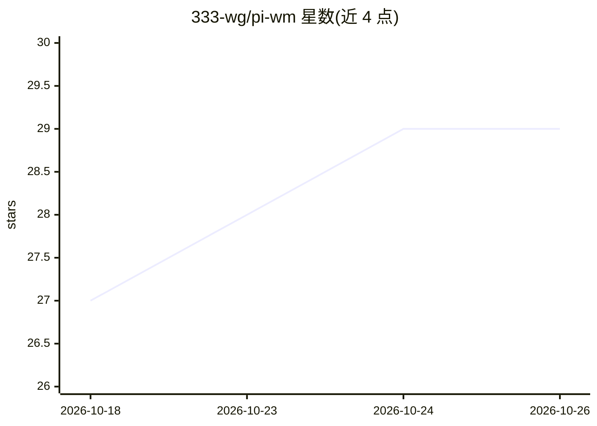

# 333-wg/pi-wm

⭐ 29 · TypeScript · MIT · 推送 2026-10-23 · [GitHub](https://github.com/333-wg/pi-wm) · [官网](https://wuming-official.pages.dev/) · 个人维护 · 中文 README

**本地优先的 AI 编程 Agent 桌面工作台（Windows/macOS）**

基于 Pi Agent 运行时的 Electron 桌面与 Web 工作台，将对话、项目文件、Git 差异、终端、Playwright 浏览器验证和多 Agent 协作集成在同一界面。用户接入自选模型服务（含 Claude/ChatGPT/Grok 授权入口），让 Agent 读代码、改文件、跑命令并检查结果；支持子任务、Agent Teams、成员模板、定时任务、MCP、Skills 与 Windows Computer Use。本地优先但非离线：远程模型请求仍发送至所配服务商。项目处于持续开发/内测状态，签名公证与安装升级验证未完成。源码运行需 Node.js 22.19+，打包版自带运行时。

## 筛选速览

| 维度 | 判定 | 备注 |
|---|---|---|
| AI 角色 | `ai-native` | 本体是模型或模型工具 |
| 许可风险 | `permissive` | MIT |
| 部署形态 | `desktop` | 安装包/桌面程序 |
| 模型依赖 | — | README 未给出锁定关系 |
| 硬件要求 | — | 无带数字的原话,不猜 |
| 安装摩擦 | `low` | 无编译、无系统依赖或容器化 |
| 成熟度 | `idea` | |

## 能力要点

- 对话、文件、Git、终端、浏览器验证与多 Agent 协作集成同一工作台
- Agent Teams：共享任务、依赖关系、成员消息与成员模板
- 手机远程接续：二维码配对后从手机查看会话与发送指令（默认关闭）
- Windows 上可启用 Computer Use 桌面操作（UI Automation/截图输入，需 Python 3）

## 适用场景

- 在本地项目中让 AI 阅读、修改代码并运行命令验证
- 组织多 Agent 团队分工协作完成较大任务
- 从手机远程查看与接续电脑上的 Agent 会话
- 通过 MCP 与 Skills 扩展 Agent 的工具能力

## 场景标签

`编码 Agent` `多智能体` `GUI 自动化` · 领域:Agent 开发

## 证据(README 行号)

> L7:  在自己的电脑上，让 AI 阅读代码、修改文件、运行命令，并检查执行结果。
> L17: Pi-Wm 把对话、项目文件、Git 改动、终端、浏览器预览和多 Agent 协作放进同一个工作台。你可以连接自己的模型服务，在本地项目里完成从理解需求、编写代码到运行验证的工作。
> L70: |官方账号|本地模式提供 Claude、ChatGPT、Grok 授权入口；可用模型与额度取决于账号权限和服务商限制。|

## 星数曲线

2026-10-18 27 → 2026-10-26 29（+2）

---
*卡片 v1 · prompt 1.4 · 生成 2026-10-26 · 置信度 high · 依据 README sha `14b7a3f25307` · [字段定义](../../DATASET.md)*
