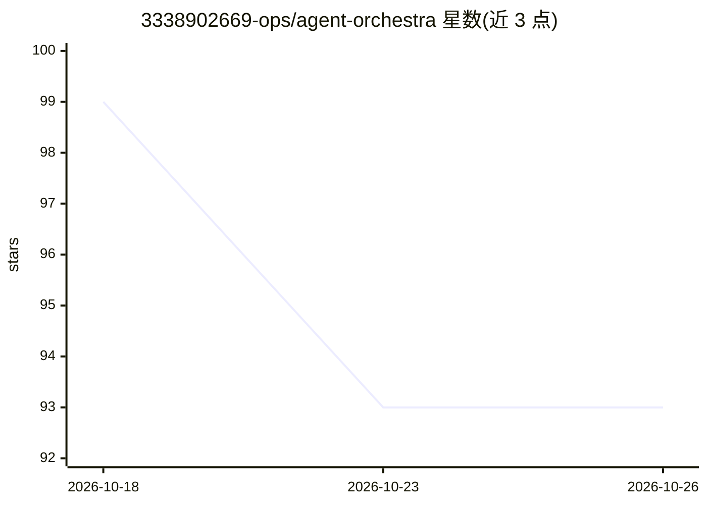

# 3338902669-ops/agent-orchestra

⭐ 93 · JavaScript · Apache-2.0 · 推送 2026-10-23 · [GitHub](https://github.com/3338902669-ops/agent-orchestra) · 个人维护 · 中文 README

**多智能体协作治理协议：以代码强制八类契约与验证门**

面向多智能体 AI 工作流的治理协调协议，定义任务、资源、所有权、交接、验证、证据、审批、恢复八类契约，并以零依赖的 Node 18+ 引擎（任务队列 CLI + 库）强制执行：每资源单主写者、验证者不得为实现者、验证门阻断未通过任务进入 done、证据分级 E1-E4、外部动作需显式审批。附可复现的符合性基准（脚本演员、无模型调用，对比单智能体与朴素多智能体的六种失败模式）与 CONFORMANCE.md 映射表，另含 SKILL.md 技能形式、一键安装脚本与配置示例。协议与特定 CLI 解耦，其他宿主可实现并验证同一基准。

## 筛选速览

| 维度 | 判定 | 备注 |
|---|---|---|
| AI 角色 | `ai-ecosystem` | LLM/agent 周边工具 |
| 许可风险 | `permissive` | Apache-2.0 |
| 部署形态 | `None` |  |
| 模型依赖 | — | README 未给出锁定关系 |
| 硬件要求 | — | 无带数字的原话,不猜 |
| 安装摩擦 | `low` | 无编译、无系统依赖或容器化 |
| 成熟度 | — | 结构信号不足 |

## 能力要点

- 八类契约以代码强制，CONFORMANCE.md 机器校验 41 条要求中 38 条 ENFORCED
- 验证者不得为实现者，验证失败经门控阻断 done 与后续派发，三轮失败后阻塞待恢复
- 可复现基准：六种失败模式、三种协调模型、脚本演员、无模型调用
- 零依赖、Node 18+，角色由 roster 数据按能力分数确定性分配

## 适用场景

- 多智能体流水线中防止智能体自报完成而无证据
- 跨会话、跨工具交接任务时保留共享记录与状态机
- 对部署/发布等外部动作施加分级审批与领域审查

## 场景标签

`多智能体` · 领域:Agent 开发

## 证据(README 行号)

> L44: **AGENT-ORCHESTRA-PROTOCOL.md** defines eight contracts - Task,
> L57: One portable, capability-first protocol for multi-agent work along **two axes**: coordinating a team inside one bat
> L98: - runs a deterministic queue: `specify -> implement -> verify -> evidence -> done`, claim locks, dry-run dispatch, 

## 星数曲线

2026-10-18 99 → 2026-10-26 93（-6）

---
*卡片 v1 · prompt 1.4 · 生成 2026-10-23 · 置信度 high · 依据 README sha `11212fa17dc1` · [字段定义](../../DATASET.md)*
