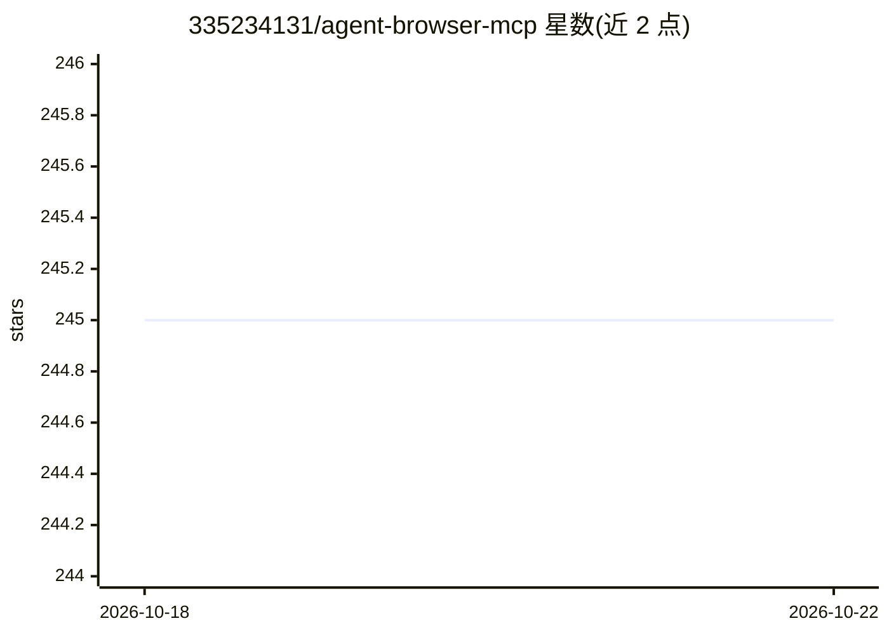

# 335234131/agent-browser-mcp

⭐ 245 · Python · MIT · 推送 2026-04-15 · [GitHub](https://github.com/335234131/agent-browser-mcp) · 个人维护 · 中文 README

**让 Agent 操作真实 Chrome 的 MCP 服务（CDP、截图、物理输入）**

由 Chrome 扩展、TMWebDriver 本地桥接与 MCP 服务三层组成的工具：连接本机已打开的真实 Chrome，保留登录态、Cookies 与已开标签页，向 Hermes、Claude Desktop、Cursor 等 MCP 客户端暴露约 20 个工具，覆盖标签页管理、页面扫描、JS 执行、原生 CDP 单条/批量调用、Cookies 读取、页面/桌面截图，以及真实鼠标键盘输入。以 Python 包与 CLI（含 doctor 诊断）形式提供，需手动加载 unpacked Chrome 扩展，操作对象为真实浏览器与桌面，作者提示仅在信任的客户端环境使用。

## 筛选速览

| 维度 | 判定 | 备注 |
|---|---|---|
| AI 角色 | `ai-ecosystem` | LLM/agent 周边工具 |
| 许可风险 | `permissive` | MIT |
| 部署形态 | `library` | 以包/库形式分发 |
| 模型依赖 | — | README 未给出锁定关系 |
| 硬件要求 | — | 无带数字的原话,不猜 |
| 安装摩擦 | `low` | 无编译、无系统依赖或容器化 |
| 成熟度 | — | 结构信号不足 |

## 能力要点

- 连接本机真实 Chrome，保留登录态/Cookies/已开标签页
- 页面扫描、JS 执行与原生 CDP 单条/批量调用
- 真实鼠标键盘物理输入与页面/桌面截图
- 提供 agent-browser-mcp CLI（extension-path/doctor 诊断）

## 适用场景

- 让 Agent 读取我已登录的后台系统或小红书页面
- 在普通浏览器自动化不稳定时改用 CDP 或真实输入
- 通过截图与页面扫描让 Agent 获取复杂页面信息

## 场景标签

`浏览器自动化` · 领域:效率与自动化

## 证据(README 行号)

> L3: 让你的 Agent 直接操作“你正在使用的真实 Chrome”的 MCP 服务。
> L95: 3. MCP 服务
> L96: - 把浏览器能力暴露为 MCP tools

## 星数曲线

2026-10-18 245 → 2026-10-22 245（+0）

---
*卡片 v1 · prompt 1.4 · 生成 2026-10-22 · 置信度 high · 依据 README sha `dda288e3ee97` · [字段定义](../../DATASET.md)*
