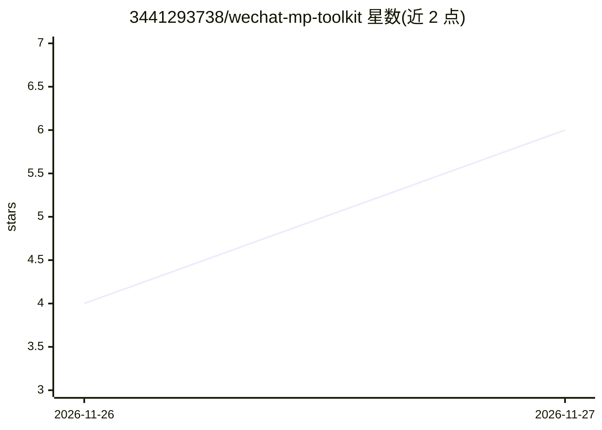

# 3441293738/wechat-mp-toolkit

⭐ 6 · Python · MIT · 推送 2026-11-25 · [GitHub](https://github.com/3441293738/wechat-mp-toolkit) · 个人维护 · 中文 README

**个人资料归档：微信公众号历史文章协议采集与导出工具**

面向个人知识管理与资料归档的微信公众号工具：通过 Windows 微信 4.2+ 同源协议分页拉取历史文章清单、高清图文 HTML、Markdown 与本地图片，配合 PAC 单域名分流将 mp.weixin.qq.com 导向本地通道，凭据仅驻留微信内存不落盘。提供 Windows 免安装 .exe 与源码两种形态，内置 6 种导出格式与 6 套模板（含 AI 知识库/RAG 模板、JSONL、离线单文件 HTML）。运行依赖本机电脑版微信并需安装临时证书。

## 筛选速览

| 维度 | 判定 | 备注 |
|---|---|---|
| AI 角色 | `ai-enhanced` | 去掉 AI 部分产品仍成立 |
| 许可风险 | `permissive` | MIT |
| 部署形态 | `desktop` | 安装包/桌面程序 |
| 模型依赖 | — | README 未给出锁定关系 |
| 硬件要求 | — | 无带数字的原话,不猜 |
| 安装摩擦 | `low` | 无编译、无系统依赖或容器化 |
| 成熟度 | — | 结构信号不足 |

## 能力要点

- 微信同源协议直采历史文章，免验证码分页拉取与完整性审计
- PAC 仅对 mp.weixin.qq.com 单域名分流，退出自动还原系统代理
- 6 种导出格式 × 6 套模板，含 JSONL 与 AI 知识库/RAG 模板
- Windows 独立 .exe 免安装，归档数据本地保存

## 适用场景

- 备份关注的公众号历史文章到本地长期阅读
- 把公众号文章导出为 JSONL/Markdown 接入 RAG 流水线
- 按日期区间和关键词筛选公众号文章并批量导出

## 场景标签

`网页抓取` · 领域:效率与自动化

## 证据(README 行号)

> L8: 面向个人知识管理与资料归档的 **微信公众号历史文章协议采集、高清图文下载与多模板导出工具**，提供 **Windows 独立桌面版（`.exe` 免安装）** 与 **iOS 玻璃拟态 Web 工作台**。
> L16: - **微信同源协议直采（Windows 微信 4.2+）**：免验证码分页拉取公众号历史文章清单、高清排版 HTML、Markdown 与本地图片，支持长 ID 防截断、自动去重与分页完整性审计。

## 星数曲线

2026-11-26 4 → 2026-11-27 6（+2）

---
*卡片 v1 · prompt 1.4 · 生成 2026-11-26 · 置信度 mid · 依据 README sha `583f0d38e3ea` · [字段定义](../../DATASET.md)*
