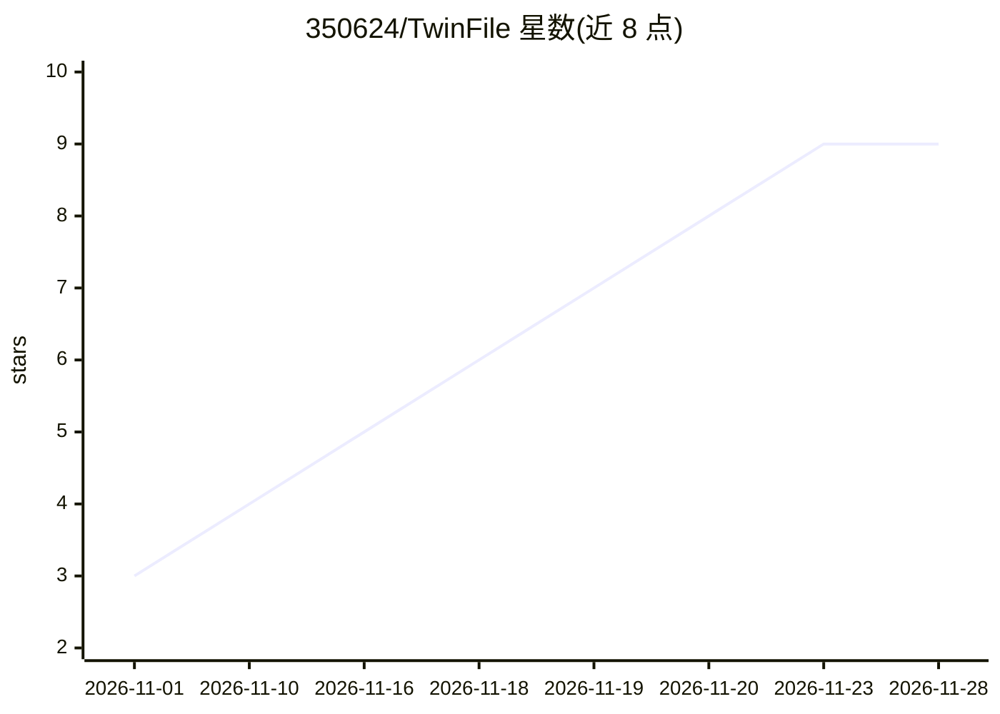

# 350624/TwinFile

⭐ 9 · Rust · GPL-3.0 · 推送 2026-11-25 · [GitHub](https://github.com/350624/TwinFile) · 个人维护 · 中文 README

**面向 Windows 用户的双栏文件管理器与 Android 工具箱**

C++20/Qt6 编写的 Windows 双栏文件管理器，功能覆盖本地/手机/ZIP/APK 内浏览与传输、APK 反编译与清单编辑、DEX/Smali 编辑、Payload 提取、文本比较校验、媒体播放等。AI 部分为可选内置扩展：侧栏助手需用户自配 OpenAI 兼容接口的地址/模型/密钥，Agent 模式默认仅列目录/搜索/读文本/算哈希并逐项确认，完全权限需显式开启。未配置 API 不影响文件管理本身。安装包在 Releases，源码构建需自备 Qt/CMake 等外部工具。

## 筛选速览

| 维度 | 判定 | 备注 |
|---|---|---|
| AI 角色 | `ai-enhanced` | 去掉 AI 部分产品仍成立 |
| 许可风险 | `viral` | GPL-3.0 |
| 部署形态 | `desktop` | 安装包/桌面程序 |
| 模型依赖 | — | README 未给出锁定关系 |
| 硬件要求 | — | 无带数字的原话,不猜 |
| 安装摩擦 | `medium` | 含编译或系统依赖之一 |
| 成熟度 | — | 结构信号不足 |

## 能力要点

- 双栏文件管理与 ADB 直连手机传输、ZIP/APK 包内浏览回写
- MCP 服务：外部 AI 客户端可连接操作授权目录与 APK/DEX
- 内置 AI 助手与 Agent 模式，默认修改前确认、授权目录限定
- 原生 DLL 插件 SDK，插件默认停用、SHA256 校验恢复

## 适用场景

- 在 Windows 上管理本地文件并通过 USB/WLAN 传输手机文件
- 浏览、编辑、重打包 APK 与 DEX/Smali
- 让 AI 助手在授权目录内查找、总结、整理文件
- 直链多并发下载与 Android Payload 提取

## 场景标签

`AI 助手` · 领域:对话与助手

## 证据(README 行号)

> L19: TwinFile 是面向 Windows 的双栏文件管理与 Android 工具箱。本版将桌面业务层、界面和设备协议迁为 **C++20 / Qt 6**，没有 Python 后端、解释器、PySide 或 Shiboken，也不
> L29: - 第一次使用：点选左栏目录，再点选右栏目标目录，回到源栏选择文件，按 `F5` 复制到另一栏；顶部“助手”打开可选 AI，未配置 API 不影响文件管理。
> L79: **内置 Agent**：输入框底部切换“Agent”，默认选择“修改前确认”并授权一个本机目录；工具结果会发送给当前 API。沿用你设置的模型/密钥，模型须支持标准 `tools/tool_calls` 和非流式 Chat Co

## 星数曲线

2026-11-01 3 → 2026-11-28 9（+6）

---
*卡片 v1 · prompt 1.4 · 生成 2026-11-20 · 置信度 high · 依据 README sha `3607dcd76868` · [字段定义](../../DATASET.md)*
