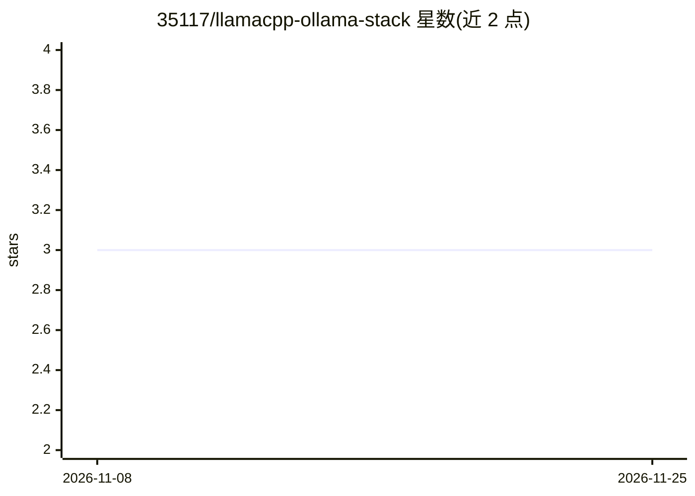

# 35117/llamacpp-ollama-stack

⭐ 3 · Python · MIT · 推送 2026-11-18 · [GitHub](https://github.com/35117/llamacpp-ollama-stack) · 个人维护 · 中文 README

**用 llama.cpp+llama-swap 复刻 Ollama 体验的本地推理栈**

把引擎换成 llama.cpp + llama-swap、同时保留 Ollama 客户端协议兼容的本地推理编排栈：提供 Ollama/OpenAI 协议翻译桥、运行时注入的人格系统（人格 id 对外即模型名）、按模型独立配置显存参数、8GB 显存上的闲置 TTL 自动卸载与倒计时管理，并带 Windows 托盘（作为服务父进程绕开进程树回收）、零依赖单文件聊天界面，以及 GGUF 显存预算估算、模型冒烟测试等脚本。面向在消费级显卡上自建本地模型服务的用户，需自行下载 llama.cpp/llama-swap 二进制与 GGUF 模型，托盘部分仅限 Windows。

## 筛选速览

| 维度 | 判定 | 备注 |
|---|---|---|
| AI 角色 | `ai-ecosystem` | LLM/agent 周边工具 |
| 许可风险 | `permissive` | MIT |
| 部署形态 | `desktop` | 安装包/桌面程序 |
| 模型依赖 | local-ok | 支持本地模型 |
| 硬件要求 | `gpu-8g` | |
| 安装摩擦 | `medium` | 含编译或系统依赖之一 |
| 成熟度 | — | 结构信号不足 |

## 能力要点

- Ollama/OpenAI 双协议兼容桥，Ollama 生态客户端无需改动
- 人格系统运行时注入，同底座多人格切换零重载
- 每模型独立 TTL 的显存驻留管理与卸载倒计时
- vram_budget.py 纯读 GGUF 元数据估算 KV 与显存账

## 适用场景

- 在 8GB 显存显卡上按需轮换多个本地模型
- 让 Continue/Roo Code/n8n 等 Ollama 协议客户端接入 llama.cpp 后端
- 为同一份模型权重管理多套系统提示词人格
- 换模型前先估算量化档与上下文能否塞进显存

## 场景标签

`模型网关` `推理引擎` · 领域:Agent 开发

## 证据(README 行号)

> L5: 保留 Ollama 的客户端生态（Continue / Roo Code / n8n / 任何说 Ollama 协议的客户端一行代码都不用改），
> L12:         ▼  127.0.0.1:11434

## 星数曲线

2026-11-08 3 → 2026-11-25 3（+0）

---
*卡片 v1 · prompt 1.4 · 生成 2026-11-22 · 置信度 high · 依据 README sha `b2103ec12cdf` · [字段定义](../../DATASET.md)*
