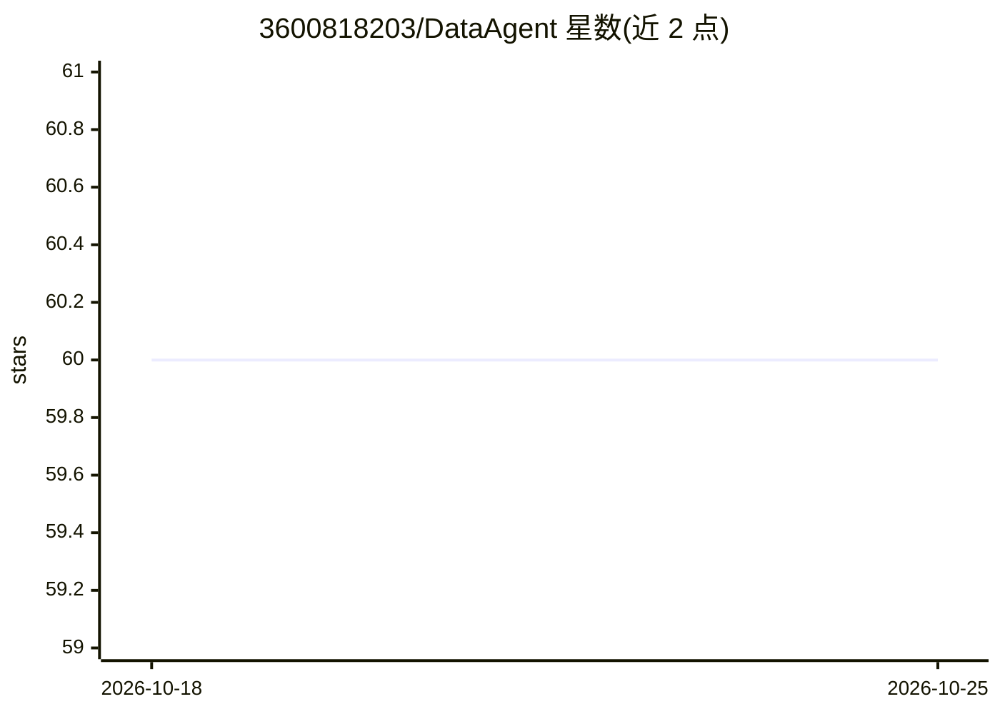

# 3600818203/DataAgent

⭐ 60 · Python · 推送 2025-11-16 · [GitHub](https://github.com/3600818203/DataAgent) · 个人维护 · 中文 README

**多智能体协作的智能数据分析系统，自动生成分析报告**

通过多 Agent 协作完成数据分析任务的系统：Plan Agent 识别用户意图并生成执行计划，路由到 Sale/Analysis/Report 等子 Agent，按 ReAct 模式调用 MCP 工具与动态生成 Python 代码完成取数和计算，最终聚合生成分析报告。数据源支持 CSV 文件与 MySQL/Doris 等兼容数据库，支持 RAGFlow 知识库增强与人工澄清中断。以 Python 源码形式提供，需分别启动 MCP 服务、后端 API 与 Streamlit 前端，通过 conf.yaml 配置各 Agent 的模型与数据源。

## 筛选速览

| 维度 | 判定 | 备注 |
|---|---|---|
| AI 角色 | `ai-native` | 本体是模型或模型工具 |
| 许可风险 | `none` | — |
| 部署形态 | `library` | 以包/库形式分发 |
| 模型依赖 | — | README 未给出锁定关系 |
| 硬件要求 | — | 无带数字的原话,不猜 |
| 安装摩擦 | `low` | 无编译、无系统依赖或容器化 |
| 成熟度 | — | 结构信号不足 |

## 能力要点

- Plan/Sale/Analysis/Report 多 Agent 分工与动态重规划，可扩展自定义 Agent
- ReAct 执行模式：MCP 工具调用 + 动态 Python 代码执行 + 自动重试反馈
- CSV 与 MySQL/Doris 数据源，按表结构自动推断维度与指标
- RAGFlow 知识库增强与人机交互（不明确时主动追问、可恢复执行）

## 适用场景

- 用自然语言对销售 CSV 数据做多维度分析并产出报告
- 接入 MySQL/Doris 数据库做问答式取数与指标计算
- 结合业务规则知识库提升复杂分析任务的准确性

## 场景标签

`多智能体` `数据分析` · 领域:Agent 开发

## 证据(README 行号)

> L7: Data Agent is an intelligent data analysis system that automatically completes complex data analysis tasks through m
> L41: - **Plan Agent**: Task planning and execution orchestration with dynamic replanning
> L44: - **Report Agent**: Result aggregation and report generation

## 星数曲线

2026-10-18 60 → 2026-10-25 60（+0）

---
*卡片 v1 · prompt 1.4 · 生成 2026-10-24 · 置信度 high · 依据 README sha `cea42fde1a8b` · [字段定义](../../DATASET.md)*
